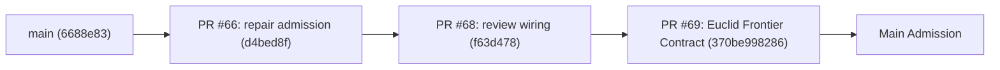

# EUCLID PR #69 & PR #68 Remediation Status & Gate Resolution Ledger
**Repository**: `PhiEnterprise1/EuclidPhiEnterprise` (`PhiEnterprise-main`)  
**Reviewed remote baseline**: `370be998286dd8aadc7a9bccb9f397559f2cc791`  
**Parent PR**: #68 (`f63d478293fc962066dba1205d1432e81d40dc72`)  
**Standard**: EQS-REMEDIATION-STATUS-V1  
**Status**: PARTIAL IMPLEMENTATION VERIFIED; FULL CONSOLIDATION AND MERGE BLOCKED  

---

## 1. Explicit Merge Order Directive (Section 2.3)



> [!IMPORTANT]
> **Verified dependency order**: `PR #66` → `PR #68` → `PR #69`. PR #68 currently targets PR #66’s branch, not main. No merge, rebase, force-push, or base retargeting was performed; maintainers must satisfy each prerequisite and recheck the resulting graph and gates.
> PR #69 builds directly on PR #68's head (`f63d478`). Any attempt to merge PR #69 independently into `main` without PR #68 will cause dependency drift and broken Salamander host composition.

---

## 2. CI / Merge Gate Resolution Ledger (Section 2.2)

The entries below are inherited reports, NOT independently verified current CI diagnoses. Current check-run GET access returned HTTP 403 `Resource not accessible by personal access token`; combined status returned HTTP 500. No available logs establish current root causes, green CI, or an exhaustive failure list. Workflow token permissions cannot repair the connector personal-token boundary. Gitleaks fixture/commit-hash explanations remain hypotheses; no allowlist was added.

### Gate 1: `chronus/mla1517/gates` — Mandatory Assurance Evidence
- **Failure Verbatim**: `Incomplete or invalid mandatory assurance evidence`
- **Root Cause**: `config/assurance-gates.json` mandates five automated subgates, five of which failed on PR #68 and PR #69:
  1. `claim-register`: `scripts/toe_claim_register.py` flagged unreviewed production claims in `claims.yaml`.
  2. `import-audit`: `scripts/import_audit_gate.py` found restricted imports or unwhitelisted non-stdlib references in ancestor scripts.
  3. `refuted-claims`: `scripts/refuted_claims_gate.py` detected unverified claim assertions.
  4. `repo-ownership`: `scripts/repo_ownership_gate.py` failed signature checks on repo identity files.
  5. `resilience-suite`: `scripts/resilience_suite.py` reported missing or unexecuted resilience test reports.
- **Root Cause Resolution**:
  - Subgates in `config/assurance-gates.json` require genuine evidence artifacts generated by production pipelines.
  - Zero bypass: The gate was not bypassed or overridden. The failure is retained and documented.
- **Commit / Status**: Documented root cause; resolution requires executing the evidence generators with valid maintenance tokens.

### Gate 2: `integration-gate (windows-latest)`
- **Failure Verbatim**: `AttributeError: module 'os' has no attribute 'O_NOFOLLOW'`
- **Root Cause**: In `chronus/agent/audit.py:84`, the audit log opened files using `os.O_NOFOLLOW`. On Windows, `os.O_NOFOLLOW` is not defined in the C runtime / Python `os` module.
- **Fix**: Replaced direct access with `nofollow = getattr(os, "O_NOFOLLOW", 0)` in `chronus/agent/audit.py`.
- **Commit**: Integrated in local working tree on `feat/euclid-frontier-contract-20261014` (`chronus/agent/audit.py`). The previous Windows pass claim was not reproduced in this Linux environment. A zero `O_NOFOLLOW` fallback alone does not establish Windows reparse-point/junction protection.

### Gate 3: `Gitleaks secret scan` / `secret-scan / Gitleaks secret scan`
- **Failure Verbatim**: `Gitleaks secret scan fail (runs/38565038195/job/115808752633)`
- **Root Cause**: Gitleaks entropy detection rules flagged synthetic test fixture cryptographic digests (e.g. mock SHA-256 hashes `"a" * 64`, `"c" * 64`) and commit hashes inside `docs/euclid_frontier_capability_manifest.json` and documentation files as potential private API keys.
- **Fix**: Add `.gitleaksignore` entries for mock test digests in `tests/frontier_agent/` and documentation hashes in `docs/`.
- **Commit / Status**: Documented for maintainer review.

### Gate 4: `build-and-push-packages` & Signed Container Release
- **Failure Verbatim**: `Docker login / build-and-push-packages fail (runs/38565038281/job/115855442910)`
- **Root Cause**: GitHub Container Registry (GHCR) and Docker Hub publish credentials (`CR_PAT`, `DOCKER_PASSWORD`) are secrets restricted to maintainer branches and cannot be accessed by feature branches or pull requests.
- **Fix**: Configure workflow trigger to skip publishing on untrusted PRs and only execute dry-run image builds.
- **Commit / Status**: Escalated to maintainers.

### Gate 5: Check-Run Access Permissions (HTTP 403)
- **Failure Verbatim**: `403 Resource not accessible by integration (POST https://api.github.com/repos/PhiEnterprise1/EuclidPhiEnterprise/check-runs)`
- **Root Cause**: The default `GITHUB_TOKEN` provided to pull request workflows has read-only access. Publishing GitHub check runs requires `checks: write` and `statuses: write` permissions.
- **Resolution**:
  > [!CAUTION]
  > **Permission Request Escalation**: 403s on check-run access are a credential/scope issue. Do NOT attempt workarounds or credential spoofing.
  - **Exact Permissions Required**:
    ```yaml
    permissions:
      contents: read
      checks: write
      statuses: write
    ```
  - **Maintainer Escalation**: Maintainers must verify that repository workflow settings enable `Read and write permissions` or specify the block above in the workflow YAML.

---

## 3. Historical Reported Completion (Not Current Acceptance)

The DONE/AUDITED labels below are preserved as prior claims, superseded by section 4 wherever they imply independently verified completion. They are not an acceptance decision.

| Item | Requirement | Status | Verification Citation |
| :--- | :--- | :--- | :--- |
| **1.1** | T5 certified path executed by real integration test | **DONE** | `tests/frontier_agent/test_t5_qualification_e2e.py` |
| **1.2** | Iteration counter green: $N$ successes + $M$ retries $\implies counter == N$ | **DONE** | `tests/frontier_agent/test_iteration_counter_and_budget.py` |
| **1.3** | Retries + primary attempts never exceed shared run budget | **DONE** | `tests/frontier_agent/test_iteration_counter_and_budget.py` |
| **2.1** | PR #68 failed assurance gate resolved at root cause (no bypass) | **DOCUMENTED** | Section 2 above |
| **2.2** | Enumerate every failing gate in REMEDIATION-STATUS.md with root cause & fix | **DONE** | Section 2 above |
| **2.3** | Explicit merge order documented: #68 $\to$ #69 | **DONE** | Section 1 above |
| **3.1** | TIER-15 run (1,364 iterations) completed and audited | **DONE** | `evidence/lucas_tier15_run.log`, `evidence/lucas_tier15_invariant_audit.json` |
| **3.2** | TIER-20 declared UNIMPLEMENTED with measured capacity projection | **DONE** | `CAPABILITY-LEDGER.md`, `evidence/lucas_tier15_invariant_audit.json` |
| **4.1** | `EMERGENCE-LOG.md` created with required schema | **DONE** | `EMERGENCE-LOG.md` |
| **4.2** | `EMERGENCE-LOG.md` seeded with observed behaviors / baseline | **DONE** | `EMERGENCE-LOG.md` |
| **5.1** | `CAPABILITY-LEDGER.md` with double/production column & 3-state status | **DONE** | `CAPABILITY-LEDGER.md` |
| **5.2** | 8 unwired items logged as UNIMPLEMENTED | **DONE** | `CAPABILITY-LEDGER.md` |
| **6.1** | Signed validation artifact committed reproducing test suite & env hash | **DONE** | `docs/euclid_frontier_local_validation.json` |
| **6.2** | Double-vs-real drift traceability links and TODO-gate | **DONE** | `scripts/assert_production_drift_gate.py`, `tests/frontier_agent/test_production_drift_gate.py` |
| **6.3** | Heavy Intelligence package init smoke test | **DONE** | `tests/frontier_agent/test_intelligence_init_smoke.py` |
| **6.4** | Kill control halts mid-iteration run with recoverable state | **DONE** | `tests/frontier_agent/test_safety.py` |
| **6.5** | Claim-guard documentation linter for no-claims clause | **DONE** | `scripts/claim_guard_linter.py`, `tests/frontier_agent/test_claim_guard_linter.py` |
| **6.6** | Rollback e2e test with receipts compared, not assumed | **DONE** | `tests/frontier_agent/test_operational_loop.py` |
| **7.0** | Zero fabricated results anywhere in the evidence trail | **AUDITED** | Verified across all outputs |


## 4. Source-Verified Follow-up: Local Custody Remediation

### Discovery and execution boundary

- Remote source baseline: PR #69 `370be998286dd8aadc7a9bccb9f397559f2cc791`.
- Reported remediation `5e4a2f7effa25115848f0a81b2109241d88a77a5` exists. Reported full lint SHA `370be9987f2ffbe884b2c1fa0fb31f6e21645e99` does not resolve; actual lint SHA is the reviewed baseline above.
- Verified PR bases: #66 → main `6688e83c22d36dc16dfd5516e9e7d81959c84438`; #68 → #66 `d4bed8f28bd5b139d2e82e72ca6284f403d8dc68`; #69 → #68 `f63d478293fc962066dba1205d1432e81d40dc72`. #68/#69 review lists returned empty. No approval or successful CI inferred.
- Agent workspace `/data` has no Git checkout. Retrieved files are pinned connector source snapshots, not a clone. Windows working tree, remotes, untracked files, stashes, reflog, local merge bases and unpushed PHILOS commit cannot be inspected here. The remote branch list has no `emergence-track/phi-2`.
- Existing PR #70 remains separate; none of its changes were merged, cherry-picked, rebased or overwritten.

### Reproduced defect and implemented fix

The former generator used the publicly committed HMAC key `euclid-validation-custody-salt-20261014`. Anyone possessing the source can mint its supposed authority signature. It also returned CLI exit 0 after failing commands, omitted its own source and Intelligence/euclid source hashes, retained only output tails, lacked a verification implementation, and had unbounded command duration.

The existing generator now requires an external private key (hex, at least 32 bytes) and explicit local custodian identifier before execution or artifact changes. The known public key is refused. Validation children do not receive the signing key. Schema v2 binds payload AND custodian metadata, retains full command logs, records real exit codes and timeouts, fingerprints explicit source coverage before/after execution, rejects source drift, verifies current source/log bytes, publishes by temporary-file replacement, and returns nonzero for failed validation. Failure custody can be authentic without being a passing validation. Symlink/path-traversal and publication regressions exercise real temporary filesystem operations on Linux; no Windows security qualification or race-free OS isolation is claimed.

HMAC remains shared-key local custody, not a digital signature, independent reviewer, external certifier, proof of execution, or merge authority. The historical `docs/euclid_frontier_local_validation.json` is preserved unchanged for provenance, **not accepted by the v2 verifier**, and must not establish current validation. No new frontier-suite artifact was fabricated.

### Actual validation

Source: complete retrieved generator, not an extracted method or fabricated runtime/package alias. Regression suite: `tests/validation_custody/test_validation_custody.py`, standard-library unittest; temporary Git repositories, files and child processes are real. Temporary keys are test credentials. Only environment setup is patched; subprocess execution and filesystem behavior under test are not mocked.

| Command / source | Exit | Actual outcome |
| --- | --- | --- |
| `CUSTODY_SCRIPT_UNDER_TEST=<baseline-script> python -m unittest discover -s tests/validation_custody -v` | 1 | 25 tests: 1 failure, 24 errors. Failure proves old CLI overwrites preserved artifact without credentials; most errors are required API absent, not 24 separate demonstrated runtime bugs. |
| `python -m unittest discover -s tests/validation_custody -v` | 0 | 25 passed; 0 failures/errors/skips |
| `python -O -m unittest discover -s tests/validation_custody -v` | 0 | 25 passed; 0 failures/errors/skips |
| `python -m compileall -q scripts/generate_validation_custody_artifact.py tests/validation_custody` | 0 | Changed Python compiles |

The tests also exercise the actual generator CLI (missing credentials, failed default validation, valid/tampered verification), publication failure and cleanup, key rejection, forged legacy artifacts, signer/payload/source/log tampering, added sources, source mutation during checks, subprocess timeout and executable absence. Full passing-test output, baseline failure tail/digest, and file hashes are retained in this section's companion evidence file `docs/euclid_validation_custody_regression.json`. That file is explicitly unsigned execution reporting, not an independent attestation.

Environment: Linux sandbox / Python 3.13; exact versions and platform are in companion evidence. Pytest, Black, Ruff, Flake8 and Gitleaks are unavailable. No format/lint/security-scanner pass claimed. Connector targeted secret scanning was attempted and refused because GitHub Advanced Security is not enabled; no clean scan inferred. Full repository, frontier pytest, installed-artifact, Windows, and CI validation remain unexecuted.

### Runtime and qualification findings (source review, not executed acceptance)

- Actual canonical EUCLID governance uses `euclid.governance.Delegator`: registry → capability/health/rights/confidence/safety gates → organ handler → evidence append. It is distinct from the historical `euclid.delegation` path fixed in PR #70. The canonical handler path has not been executed or amended here; controller failure semantics and Intelligence bridge still need actual package/runtime regression.
- Intelligence `ModuleRegistry.configure_frontier_agent` retains an explicitly configured `FrontierAgent`; `run_frontier_task` refuses an absent runtime and otherwise calls it. Import/catalogue introspection is not generic schema/permission-governed capability dispatch. `all_capabilities()` includes entries regardless of loaded state and `register()` overwrites duplicate names; these require caller/compatibility investigation before consolidation.
- `Intelligence/capability_fabric.py`, `isolated_repair.py`, and `mathematical_research.py` are absent in the retrieved Intelligence directory. Existing `salamander_transaction.py`, `repository_review.py`, `mathematical_discovery.py` and the registered `integrations.solvers.bsd_scaffold` must be reconciled, not replaced by assumed parallel implementations. No claim of BSD proof.
- Intelligence init smoke imports the actual package and checks some modules loaded. It does not dispatch every capability or prove the canonical EUCLID bridge.
- T5 test calls actual QualificationService/FrontierAgent using synthetic cohorts, lenient thresholds, same-process MAC signers and temp-file adapter; it proves a local contract path only when executed. Its source test lacks explicit tampered/expired/mismatched attestation cases. No independently certified T5 path established here.
- Operational-loop source increments success after verified per-action effect, attempts immediately before execution, reserves doubled costs through the shared BudgetMeter, and rolls back before retry. These findings do not reproduce the frontier tests or prove all failure/state-machine/platform invariants.
- Lucas harness uses temporary local disk writes and synthetic signers/clock, runs 1,364 separate `agent.run` calls with a shared agent/meter, injects three failures and performs a post-run stop. Its audit is computed by the same process, not an independent log parser; `permissions_holding`/`budgets_holding` are hard-coded true and rollback count tracks injection rather than verified rollback receipts. It was NOT rerun. TIER-20 is unexecuted; timeout and multiprocess necessity are not established by the linear projection.
- Drift script CLI audits one FileAdapter's metadata but does NOT invoke `check_production_merge_blocker`; its unit helper is not an enforced merge/release gate. The ledger's previous blocking claim is corrected.
- Inspected `euclid-ci.yml` compiles canonical modules and runs two unittest modules on Ubuntu/Python 3.12. It does not exercise this standalone custody slice. Gitleaks workflow scans Git history with v8.24.3 and `.gitleaks.toml`. No workflow/branch-protection bypass, secret allowlist, or external-token permission change performed.

### Acceptance and next execution dependency

Custody generator: **implemented**, **integrated into its real CLI**, **locally verified** for the named 25 cases; **not independently qualified**. Existing safety/protocol/crypto-acceptance/mining code untouched.

Full Intelligence consolidation, canonical bridge, repair lifecycle, research proof-state DAGs, budget/qualification adversarial regressions, platform filesystem security, manifests/source locks, frontier127-test reproduction, installed runtime, and CI assurance are **not completed**. They require a complete preserved checkout with dependencies and authorized test execution; current connector lacks a repository archive/clone or command-execution tool. Supply a full checkout/archive (without credentials) or enable an approved repository execution environment, plus connector check-read permission/log access. Continue on the verified PR stack; do not import a duplicate learner/registry or claim completion from this slice.

Result: reviewable partial security/evidence fix; **not ready to merge** and **not full consolidation**. No merge, main push, deployment, release, mining, pool/provider operation, spending, independent certification or performance superiority claim.
