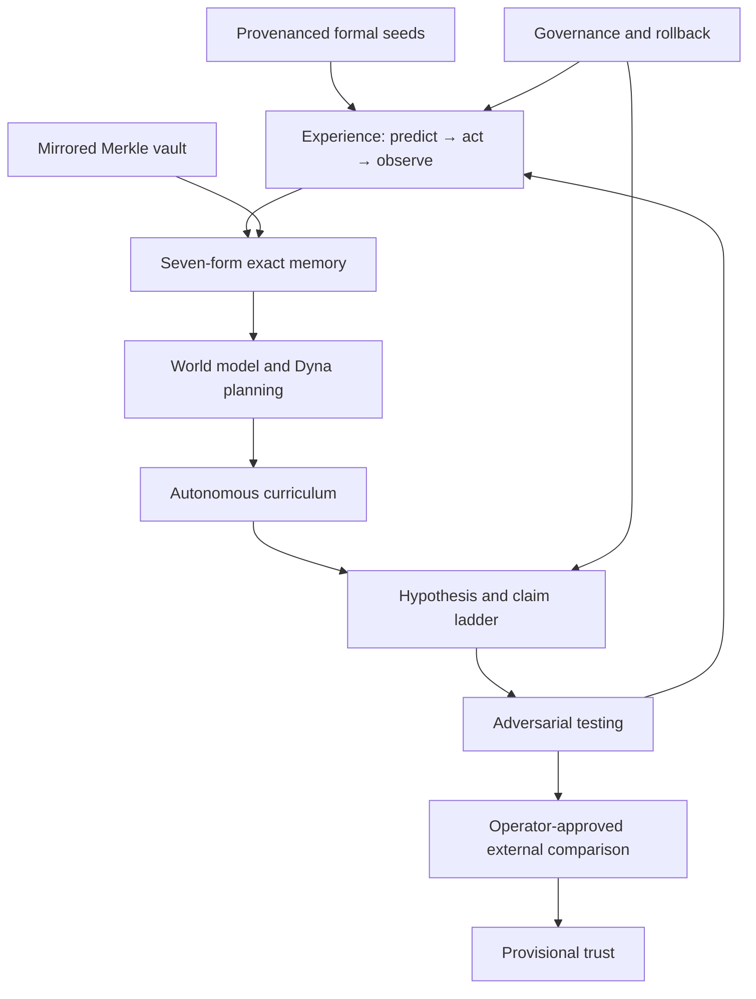

## Research architecture

## Core components
<table fit-page-width="true" header-row="true">
<tr>
<td>Component</td>
<td>Purpose</td>
<td>Evidence boundary</td>
</tr>
<tr>
<td>Governed learning system</td>
<td>Seeds, event lineage, memory forms, claims, curriculum, consolidation</td>
<td>No external self-award</td>
</tr>
<tr>
<td>Experience superlearner</td>
<td>Q learning, world model, Dyna planning, novelty, transfer</td>
<td>Internal synthetic evidence</td>
</tr>
<tr>
<td>Memory vault</td>
<td>Byte-exact, canonical, compressed, mirrored, reversible preservation</td>
<td>Continuity—not cognition</td>
</tr>
<tr>
<td>AGI/ASI evaluators</td>
<td>Longitudinal growth, uncertainty, regression, external-baseline gates</td>
<td>Both gates false</td>
</tr>
<tr>
<td>Governed modification</td>
<td>Approval, protected paths, validation, rollback</td>
<td>Production apply disabled</td>
</tr>
</table>
## Reproduction sequence
```bash
PYTHONPATH=. python3 -m unittest -v tests.test_euclid_experience_superlearner
PYTHONPATH=. python3 scripts/run_euclid_experience_benchmark.py
```
The full research archive contains the implementation, tests, benchmark protocol, governed-learning state, experience state, evidence reports, logs, source hashes, manifest, research chronology, and reproduction guide.
## Review checklist
- [x] Focused unit and invariant tests retained.
- [x] Integrated regression retained.
- [x] End-to-end production harness retained.
- [x] Mining readiness retained.
- [x] Canonical JSON preserved.
- [x] Source hashes preserved.
- [x] Mirrored vault restoration verified.
- [x] Unsupported superiority claim refused.
- [ ] External held-out benchmark.
- [ ] Independent replication.
- [ ] Long-horizon retention benchmark.
- [ ] Embodied telemetry benchmark.
- [ ] Human-expert reference baselines.
## Repository landmarks
- `hyba_substrate/euclid_learning_system.py`
- `hyba_substrate/euclid_experience_superlearner.py`
- `hyba_substrate/memory_preservation.py`
- `tests/test_euclid_learning_system.py`
- `tests/test_euclid_experience_superlearner.py`
- `scripts/run_euclid_learning_baseline.py`
- `scripts/run_euclid_experience_benchmark.py`
- `artifacts/evidence_archive/euclid_learning_vault`
- `/data/euclid_learning_vault_mirror`
## Stewardship rule
Future changes must be additive, reviewable, tested, reversible, hash-addressed, and chronologically documented. Existing evidence must not be overwritten merely because a later theory is more attractive.