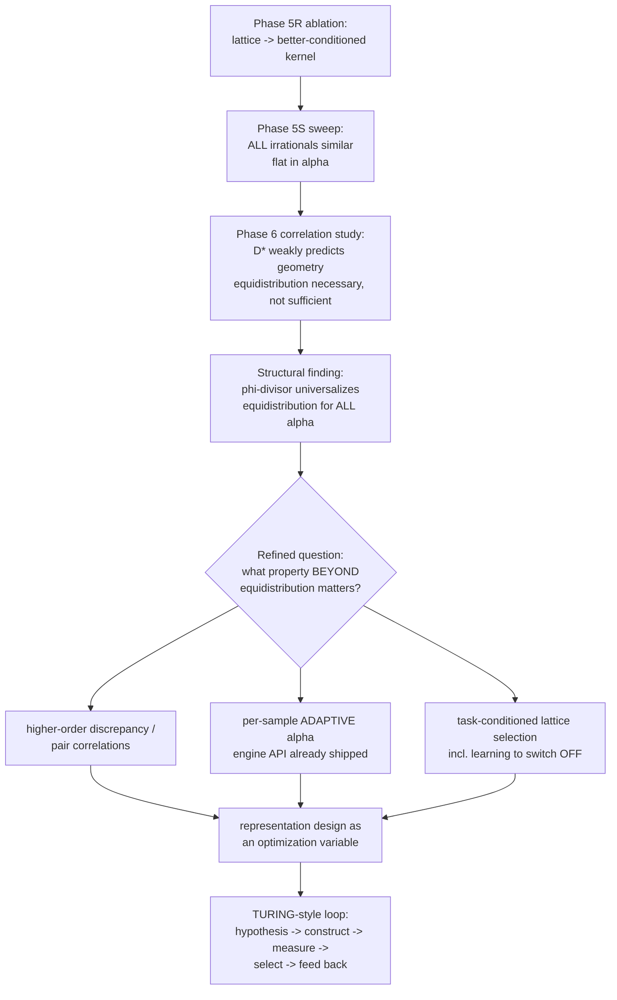

# Phi Mechanism Report — Hunting the Real Property

**Date**: 2026-08-25
**Question posed**: What mathematical property do successful lattices share?
Raw data: `PHI_MECHANISM_RESULTS.json`. Instrument: `python_backend/phi_mechanism.py`.

## Discovery 1 (structural): the divisor universalizes equidistribution

The lattice phases are `frac(j^2 * alpha / phi)`. Because the DIVISOR is
irrational, **every nonzero alpha - including "rational" ones like 1/2 or
1/4 - produces an irrational step `alpha/phi`**, hence an equidistributed
phase set. Rationality of alpha is destroyed by the divisor before it can
collapse the geometry.

Consequences, all confirmed in data:

- The Phase-5R alpha sweep was flat for EVERY alpha (not just irrationals).
- Rationals and irrationals sit in the same metric band in the correlation
  study; no rational collapse appears anywhere.
- Ironically: phi DOES matter - but as a universal irrationalizer in the
  divisor position, not as a privileged constant in the numerator.

## Discovery 2: discrepancy alone does not predict kernel geometry

Correlations across 30 heterogeneous alphas (dim=256, 3 seeds):

| pair            | Pearson | Spearman   |
| --------------- | ------- | ---------- |
| D* vs eff_rank  | -0.053  | **-0.245** |
| D* vs cond      | +0.046  | +0.245     |
| D* vs alignment | -0.042  | -0.238     |

Direction is consistent with H_class (worse coverage -> worse geometry) but
magnitudes are weak: counterexamples exist (random_04: worst D*=0.046 yet
eff_rank 32.9, cond 1.32). Equidistribution is necessary-ish, not sufficient.

## Discovery 3: task-dependence is real

| task     | none      | rational  | irrational mean        |
| -------- | --------- | --------- | ---------------------- |
| sin_cos  | 0.447     | 0.453     | **0.460** (beats both) |
| xor_quad | 0.433     | **0.467** | 0.453                  |
| circle   | **0.820** | 0.747     | 0.807 (lattice HURTS)  |

No arm dominates. The lattice is a prior, not a law.

## Discovery 4: naive alpha-learning fails informatively

Unsupervised alignment-maximization found alphas (sin_cos 0.686+-0.24,
xor_quad 0.651+-0.33) that did NOT improve test accuracy (~~0.50); on
`circle` it converged to tiny alpha*~~=0.03 consistently (acc 0.860 vs
none 0.820) - i.e., alignment is a weak proxy and the learner mostly wants
to SWITCH THE LATTICE OFF when it does not help. That is itself a useful
signal: an honest adaptive layer should be able to learn "no lattice".

## Verdict on the two hypotheses

- H_magic (phi uniquely privileged): REJECTED at fixed-alpha.
- H_class (equidistribution is the whole mechanism): PARTIAL - necessary
  flavor, insufficient predictor; weak Spearman signal in predicted direction.

The refined mechanism question for Phase 7: what property of the phase set -
beyond first-order equidistribution (e.g., second-order discrepancy,
pair-correlation statistics, spectral gap of the Koopman operator over the
phase map) - actually controls downstream conditioning? And does per-sample
ADAPTIVE alpha (engine support already shipped) outperform any fixed alpha?

## Trajectory Map (Mermaid)

## Test status

26/26 passed (`test_phi_science.py`, `test_igpu_opencl_wiring.py`).
