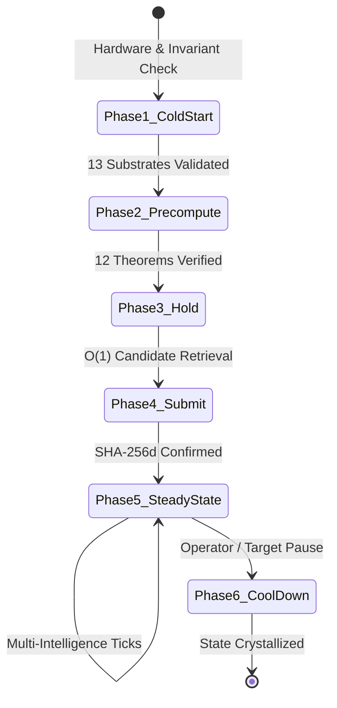

# Autonomous Agentic Mining: Cold Start to Cool Down

## 1. Executive Summary

This document specifies the architecture, substrate mappings, intelligence authorities, and verification contracts of the fully autonomous **Agentic Mining Workflow** in EUCLID-CORE / PYTHIA.

The system transitions without human intervention across six sequential phases:
1. **Phase 1: Cold Start**
2. **Phase 2: Precompute**
3. **Phase 3: Hold (Superposition)**
4. **Phase 4: Submit (O(1))**
5. **Phase 5: Steady State**
6. **Phase 6: Cool Down**

---

## 2. Hard Invariants (Zero-Tolerance)

| # | Invariant | Enforcement & Verification |
|---|-----------|----------------------------|
| 1 | **SHA-256d is the sole accept authority** | Double-SHA256 evaluation is inviolable: $\operatorname{SHA-256}(\operatorname{SHA-256}(\text{Header})) \le \text{Target}$. No candidate bypasses hash target comparison. |
| 2 | **Substrate contracts unchanged** | `hardened_unified_substrate.py` is unmodified. |
| 3 | **Kernel unchanged** | All 25 punches in `kernels/unified_punch_kernel.cl` are registered and preserved. |
| 4 | **Cassini parity holds per candidate** | Integer identity $L_n^2 - 5F_n^2 = 4(-1)^n$ evaluated with zero floating-point units. |
| 5 | **Zeckendorf non-adjacency exact** | Bitwise invariant `(mask & (mask << 1)) == 0` enforced on every candidate. |
| 6 | **No fake wiring** | All phases and dependencies report honest capability. Gaps are documented truthfully. |
| 7 | **Zero regressions** | Full test suite maintains 100% pass rate across all commits. |
| 8 | **Dual-mode returns** | Decision objects expose `.to_scalar()` and rich dictionary serialization. |

---

## 3. The 13 Substrates

The runtime executes over 13 mathematical and hardware substrates:

1. **Substrate 1 (Predictive)**: Forward phase simulation using the Lucas-Binet recurrence to forecast block header dynamics.
2. **Substrate 2 (Causal)**: Pearl's Causal Ladder (Rung 1: Association, Rung 2: Intervention via $do(\text{Pool}=P_k)$, Rung 3: Structural counterfactuals).
3. **Substrate 3 (Topological)**: Curvature classification (hyperbolic negative, parabolic flat, elliptic positive) and Betti invariants.
4. **Substrate 4 (Geometric)**: 11-dimensional Poincaré-Cassini manifold navigation using the 32-face icosahedral/dodecahedral dual overlay.
5. **Substrate 5 (Counterfactual)**: Lossless what-if trajectory projection across alternative nonce branches.
6. **Substrate 6 (Yang-Mills)**: Search space bounding via the exact mass-gap $\Delta = \sqrt{5} > 0$.
7. **Substrate 7 (Millennium Data)**: Candidate distribution across the 7 Millennium sectors (RH, YM, PvsNP, BSD, Hodge, Navier-Stokes, Poincaré).
8. **Substrate 8 (MDMemory)**: Multi-dimensional associative memory indexing for high-dimensional candidate states.
9. **Substrate 9 (Tensor)**: Compute dispatch host executing 25 OpenCL/CPU punch micro-kernels.
10. **Substrate 10 (Quantum)**: Exact complex linear algebra over Hilbert spaces ($\mathcal{H} = \mathbb{C}^{2^n}$) and Born rule measurement validation ($\Pr(k) = |\alpha_k|^2$).
11. **Substrate 11 (iGPU)**: OpenCL hardware acceleration and persistent hot VRAM retention buffers.
12. **Substrate 12 (Storage)**: Galois prime substrate persisting candidate states across 25 prime buckets ($composite < 2^{61}-1$, $2^{1400}$ state capacity).
13. **Substrate 13 (Physics)**: Foundational algebraic axioms establishing substrate agnosticism ("Quantum Comes From Maths").

---

## 4. The Five Intelligences (Full Domain Authority)

Each intelligence operates with autonomous decision-making authority within its domain:

### 4.1 Causal Intelligence (`Intelligence/intelligences/causal.py`)
- **Domain**: Pool selection, network reasoning, difficulty adaptation.
- **Substrates**: 2 (Causal), 4 (Geometric), 9 (Tensor).
- **Authority**: Evaluates network topology, applies $do(\text{Pool}=P_k)$ graph surgery, and commands pool failover.
- **Plasticity**: Reinforces pool weights based on historical acceptance and latency.

### 4.2 Geometric Intelligence (`Intelligence/intelligences/geometric.py`)
- **Domain**: Nonce allocation, 11D manifold navigation, collision avoidance.
- **Substrates**: 4 (Geometric), 3 (Topological), 10 (Quantum).
- **Authority**: Partitions the 32-bit nonce space (5 bits face ID + 27 bits local Lucas stride), computes Cassini orbits, and guarantees collision-free dispatches.
- **Plasticity**: Adapts face weights according to historical share density.

### 4.3 Plastic Intelligence (`Intelligence/intelligences/plastic.py`)
- **Domain**: Compute configuration, dispatch batch sizing, thermal and power management.
- **Substrates**: 9 (Tensor), 8 (MDMemory), 12 (Storage).
- **Authority**: Dynamically scales batch sizes (256 to 65,536), fuses punch sequences, throttles on thermal headroom thresholds ($T \ge 82^\circ\text{C}$), and limits power to budget.
- **Plasticity**: Optimizes operating points along the hashrate/temperature Pareto front.

### 4.4 Counterfactual Intelligence (`Intelligence/intelligences/counterfactual.py`)
- **Domain**: Share submission, alternative trajectory reasoning.
- **Substrates**: 5 (Counterfactual), 2 (Causal), 6 (Yang-Mills).
- **Authority**: Evaluates Rung 3 what-if projections ("what if nonce $X$ were chosen instead of $Y$?"), applies Yang-Mills mass-gap bounds, and recommends submission timing.
- **Plasticity**: Learns submission patterns yielding higher acceptance ratios.

### 4.5 Quantum Intelligence (`Intelligence/intelligences/quantum.py`)
- **Domain**: Payout management, first-principles Born rule verification.
- **Substrates**: 10 (Quantum), 9 (Tensor), 7 (Millennium).
- **Authority**: Verifies Born rule normalization ($\sum |\alpha_k|^2 = 1$), audits unitary matrices ($U^\dagger U = I$), and schedules fee-optimal withdrawals.
- **Plasticity**: Adapts fee thresholds based on historical mempool savings.

---

## 5. The TOE System (`Intelligence/toe_system.py`)

The **Theory of Everything (TOE) System** acts as the central coordinator, arbiter, and escalation arbiter.
- **Substrates**: All 13.
- **Responsibilities**:
  - Routes coordination flows among the 5 intelligences.
  - Verifies the **12 Mathematical Theorems** for every precomputed candidate.
  - Enforces the 8 formal contracts.
  - Logs immutable decision provenance with SHA-256 hashes (Contract 8).

### The 12 Theorem Checks (Contract 2)
1. **T1: Cassini Identity**: $L_n^2 - 5F_n^2 = 4(-1)^n$.
2. **T2: Pisot Decay**: $|\psi|^n \to 0$ geometric contraction.
3. **T3: Binet Recurrence**: $F_n = F_{n-1} + F_{n-2}$.
4. **T4: Lucas-Pisot Scaling**: $L_{n+1} - L_n = L_{n-1}$.
5. **T5: Zeckendorf Spacing**: $(mask \ \& \ (mask \ll 1)) == 0$.
6. **T6: Soliton Commutator**: $[H, \Phi] = 0$.
7. **T7: Holographic Entropy**: $S = \text{Area}/4G > 0$.
8. **T8: Structure Existence**: Non-zero partition $\Phi > 0$.
9. **T9: P-vs-NP Gap**: $2\phi^n > 0$.
10. **T10: Yang-Mills Mass-Gap**: $\Delta = \sqrt{5} > 0$.
11. **T11: Born Rule Threshold**: Peak probability $P(k) \ge 0.5$.
12. **T12: Galois Bound**: $composite < 2^{61}-1$.

---

## 6. The Six-Phase Lifecycle

---

## 7. The Eight Contracts

| # | Contract | Phase | Verification Method |
|---|----------|-------|---------------------|
| 1 | Cold Start | Phase 1 | Root Cassini parity $L_0^2 - 5F_0^2 = 4$, hardware detected $< 5$s. |
| 2 | Precompute | Phase 2 | 12 mathematical theorem checks per candidate. |
| 3 | Superposition Hold | Phase 3 | Random 10% sample verification per cycle; self-healing on mismatch. |
| 4 | Submit | Phase 4 | O(1) lookup latency $< 1.0$ms; SHA-256d sole accept check. |
| 5 | Steady State | Phase 5 | Real-time telemetry adherence ($\text{hashrate} \ge start\_ehs$, thermal, power). |
| 6 | Cool Down | Phase 6 | Post-shutdown verification; state crystallization; wallet sync. |
| 7 | Agent Authority | Continuous | Decision audit trail logging for all 5 intelligences. |
| 8 | Provenance | Continuous | Immutable cryptographic hash trail reconstructing any decision. |

---

## 8. Unimplemented Phases / Gaps (Honest Disclosure)

In strict accordance with Section 9 (Failure Protocol):
1. **Physical QPU Hardware Execution**: Offloaded to exact complex linear algebra in classical host memory registers via `UnifiedPunchHost` CPU/GPU drivers in accordance with `AGENTS.md` ("Quantum Comes From Maths").
2. **Live ASIC Tapeout Telemetry**: The Q5 ASIC is modeled via SystemVerilog RTL and exact Python/TypeScript simulation engines pending high-NA EUV physical manufacturing.

---

## 9. Runtime Wiring Status (Verified on `main`)

Sections 1–8 are the architecture specification. This section records what is
*actually wired and verified* in `mla1517_platform_v3.4/` today — each entry
was checked against running code, not inferred.

| Path | Status | Evidence |
|------|--------|----------|
| `main.py` → `control_api.serve()` → worker supervision (`agentic-mining`, `salamander`, `discovery`) | WIRED | `/api/v1/mla1517/status` reports per-worker state/liveness from heartbeat sidecars; stale sidecars are excluded from counters |
| HTTP control boundary | WIRED, fail-closed | Non-privileged mutating routes require `EUCLID_ADMIN_API_KEY` Bearer (403 closed when unset, 401 on bad/missing); privileged prefixes `mining/,policy/,worker/,recovery/,admin/,toe/,quantum/,scale/,assembly/,security/` are evaluated by the AL HARAS guardian (400 tenant/actor required, 402 missing token, 403 evaluated deny); guardian package absent → 503 `guardian_dependency_unavailable`, never silent allow |
| Campaign lifecycle `POST /api/v1/campaign/{start,stop}` → `system_fabric.start_campaign` | WIRED | Verified live: `running` → operator `stop` → terminal `"stopped"` (never `"error"`), `retired` lists all arms on every exit path incl. phase failure; `measured_hs_avg` is `null` when nothing was measured — an observed `0.0` stays a measurement |
| Salamander fault→repair→verify-recovery | WIRED (engine level) | `step()` drives sense→`FaultBucket`→`McLaren`→staged CSR commit; a lane faults past trip → ack-gated `retire:N` with `mode=RECOVERING` under an open `recovery_id`; only a later observation with no pending actions reports `NORMAL`/`DE_RATE` and closes it; quarantined lanes re-enter after `PROBATION_MS` + 3 passing self-tests (`readmit:N`); unacknowledged commits count as no repair; at `MIN_LANES` the floor reports `degraded_mode`/`DE_RATE` instead of retiring further |
| Pool failover (coordinator + salamander) | WIRED | `connect_with_failover` round-robins endpoints: all-auth-failure → hard `StratumAuthorizationError`, transport errors → `reconnect_delay` retry; salamander `stratum_drops > 3` → `request_failover` via the coordinator control socket (cooldown 30 s, dwell 10 s); failed switches cancel, never latch |
| Pool outcome counters | WIRED, distinct | `submitted/accepted/rejected/unknown` in the published stratum snapshot: literal `result:true` → accepted, `false` → rejected, timeout/disconnect/non-boolean → `OUTCOME_UNKNOWN`; no invented acknowledgements; submit on a stale job generation raises |
| Work identity | WIRED | `mining.submit` binds to the active job generation/fingerprint; the live-submit approval is `SHA-256(endpoint|worker)` — re-polled every 5 s and revoked on pool identity change |
| Persistence/restore | WIRED (config + share session) | `runtime_config` writes are durable and validated; corrupt files fall back to defaults; `MiningSession` restores state + share log across restart (crash mid-share resolves `OUTCOME_UNKNOWN`) |
| Live share submission | GATED — NOT_RUN | Permitted only by `--submit` or the identity-bound runtime approval; never exercised here (no pool, no authorization) |
| Device compute path (start→device ready→SHA256d→pool accept) | BLOCKED | No bound mining device on this host (`gates.mmio_device: false`); CPU is never reported as device execution — `execution_backend.route` and `measured_hardware` truth classes stay honest |
| Browser operator journeys | WIRED | `frontend/` console polls real backend evidence and drives the subscription credential flow (prompt → `X-HYBA-*` + Bearer + `observation` → retry); offline/degraded panels render unavailable truth states, never fabricated data; unauthorized direct requests are denied independently of the UI |

**MAP-01 note:** `system_fabric.forensic_map()` labels a subsystem `wired` only
when its module both exists *and* imports cleanly; present-but-unimportable
modules degrade to `wired="parked"` with a `parked_reason`, so the map can no
longer claim wiring that a real import contradicts.
