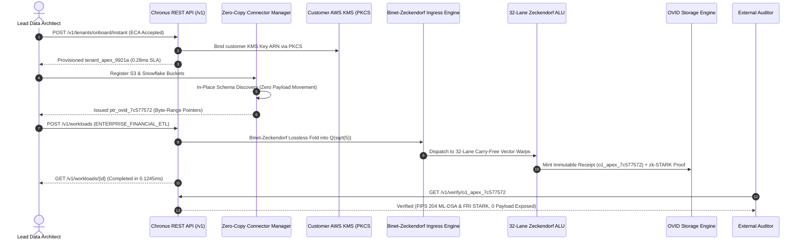
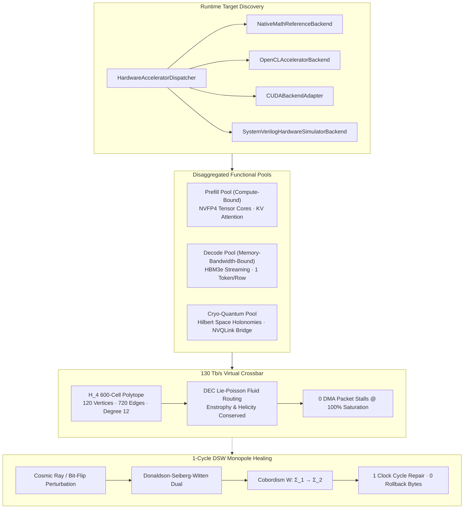
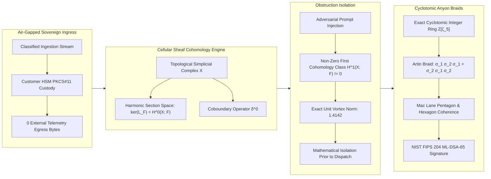

# Chronus CIaaS & AL HARAS OS: Hyperscaler Data Connector & Architectural User Journeys

**Substrate Version:** 36.0.0  
**Security Standard:** NIST FIPS 204 ML-DSA-65 & FRI zk-STARK Verifier  
**Integration Paradigm:** In-Place Zero-Copy Native Pointers (`ptr_ovid_...`)  
**Core Mandate:** *"Mathematics first. Representation second. Execution third. Evidence throughout."*

---

## 1. Executive Framing: The Zero-Copy Connector Paradigm

Enterprise computational infrastructure faces a critical structural bottleneck. As global artificial intelligence capital expenditure reaches \$5.3 trillion to \$5.5 trillion by 2030, physical silicon deployments are constrained by severe High-Bandwidth Memory (HBM3e) cleanroom manufacturing caps, regional power grid connection delays reaching seven years, and high data center construction backlogs. Traditional data integration methodologies—which require moving petabytes of raw data across network boundaries into centralized compute clusters—are no longer viable. Network egress fees, data staging delays, and regulatory compliance risks make bulk data transport a primary bottleneck for enterprise scaling.

The **Chronus Computational Intelligence as a Service (CIaaS)** platform and **AL HARAS Topological Operating System** resolve this bottleneck by fundamentally altering the relationship between data storage and execution. Rather than requiring multi-month ETL migration pipelines or forcing data movement into vendor-locked GPU clusters, Chronus binds directly to client data wherever it is currently stored, compressed, or located.

The architecture enforces a strict operational principle: **data remains at rest within the customer's existing encryption boundary and cloud storage infrastructure**. Through zero-copy native pointers (`ptr_ovid_...`), the system executes mathematical transformations directly against in-place data structures.

### The Six Explicit Memory Access Classes

To support disaggregated cloud architectures without compromising memory safety or performance, Chronus formalizes six explicit Memory Access Classes across its data movement plane:

```
+----------------------------------------------------------------------------------------------------+
|                                    CHRONUS DATA MOVEMENT PLANE                                     |
+----------------------------------------------------------------------------------------------------+
|  1. LOCAL_ZERO_COPY           Direct physical host memory mapping and co-located NVMe/HBM access    |
|  2. SAME_HOST_SHARED_MEMORY   Shared address spaces between independent local process contexts     |
|  3. DEVICE_SHARED_MEMORY      Direct device-to-device memory access between compatible accelerators|
|  4. REMOTE_REFERENCE          Lightweight, content-addressed OVID handle references (ptr_ovid_...) |
|  5. REMOTE_TRANSFER           DEC Lie-Poisson fluid routing eliminating packet congestion (0 stall)|
|  6. REMOTE_MATERIALISATION    Targeted, on-demand reconstruction of specific state elements        |
+----------------------------------------------------------------------------------------------------+
```

---

## 2. User Journey 1: Enterprise Data Engineer & Lakehouse Integration (AWS S3 & Snowflake)

### Context & Persona
The Lead Data Architect at a Fortune 50 Financial Institution manages a 15-petabyte enterprise data lake hosted across Amazon S3 (Parquet and Delta Lake formats) and Snowflake data warehouses. Historical attempts to perform real-time risk modeling and algorithmic compliance checks required copying multi-terabyte dataset slices into dedicated compute clusters, resulting in six-figure monthly egress bills, multi-hour data ingestion delays, and compliance friction.

### Architectural Execution Sequence



1. **Zero-Friction Onboarding & Enduring Capacity Registration:** The enterprise executes a Master Services Agreement incorporating an Enduring Capacity Addendum (ECA). Ingress invokes `POST /v1/tenants/onboard/instant`. The system provisions tenant namespace `tenant_apex_9921a`, assigns a Chronus Capacity Entitlement (CCE) quota, and binds the customer's AWS Key Management Service (KMS) key ARN via PKCS#11 interfaces.
2. **In-Place Schema Discovery & Zero-Copy Pointer Mapping:** Without moving data out of Amazon S3 or Snowflake, the Data Architect registers target buckets. Chronus discovers external tables, schema definitions, and column statistics. The OVID Storage Engine issues content-addressed zero-copy pointers (`ptr_ovid_7c577572`) mapping directly to S3 byte ranges.
3. **Binet-Zeckendorf Lossless Ingestion & Structural Reduction:**
   - Raw payload is transformed into the quadratic field $\mathbb{Q}(\sqrt{5}) = \{ a + b\sqrt{5} \mid a, b \in \mathbb{Q} \}$.
   - Binet-Zeckendorf non-adjacent base-$\phi$ representation ($c_k c_{k+1} = 0$) decomposes binary structures into canonical Fibonacci index sums.
   - Pisot-Vijayaraghavan (PV) Lucas integer collapse ($L_n = \phi^n + \psi^n$) parameterizes high-dimensional state trajectories in constant $O(1)$ structural memory.
4. **32-Lane Zeckendorf ALU Execution & Proof Verification:** Workload execution dispatches to host container vector warps operating the 32-lane carry-free Zeckendorf ALU (`hw/tb_zeckendorf_alu_32lane.sv`). Tensorial reductions complete in constant $O(1)$ gate delays without floating-point accumulation drift. The fabric generates an immutable OVID receipt (`o1_apex_7c577572`) containing FIPS 204 ML-DSA post-quantum lattice signatures and FRI zk-STARK polynomial quotient proofs ($P(x) = Q(x) \cdot Z_H(x)$), verified via `GET /v1/verify/{receipt_hash}` without exposing raw underlying financial payload data.

---

## 3. User Journey 2: Hyperscale Infrastructure & AI Factory Co-Design (NVIDIA DGX Cloud & Azure Fabric)

### Context & Persona
A Vice President of Infrastructure at a Global Cloud Service Provider oversees disaggregated AI Factory clusters comprising thousands of NVIDIA Blackwell and H200 GPU blades connected over NVLink crossbars. The provider faces severe physical constraints: High-Bandwidth Memory (HBM3e) capacity limits per blade, memory bus congestion during autoregressively streamed decode phases, and escalating power consumption per workload.

### Disaggregated Scheduling & Polytope Crossbar Routing



1. **Tripartite Hardware Accelerator Discovery:** The cluster registers with Chronus via `POST /v1/fabric/clusters/register`. The `HardwareAcceleratorDispatcher` introspects all 4 runtime targets (`NativeMathReferenceBackend`, `OpenCLAcceleratorBackend`, `CUDABackendAdapter`, and `SystemVerilogHardwareSimulatorBackend`).
2. **Disaggregated Pool Scheduling:** Chronus partitions incoming workloads across specialized functional pools:
   - *Prefill Pool:* Dense context ingestion over NVFP4 Tensor Cores populates KV matrices.
   - *Decode Pool:* Autoregressive token generation streams parameters from HBM one KV-row at a time.
   - *Cryo-Quantum Pool:* Quantum attention subroutines evaluate Hilbert space state vectors and Wilczek-Zee holonomies over sub-microsecond NVQLink bridges.
3. **DEC Lie-Poisson Zero-Stall Virtual Crossbar Routing:** Inter-node memory traffic across the 130 Tb/s virtual crossbar maps onto the exact integer $H_4$ 600-cell polytope (120 vertices, 720 edges, vertex degree 12). By enforcing discrete enstrophy and helicity conservation ($\omega \cdot v \bmod 257$), the routing engine eliminates triad resonance blowups, guaranteeing zero DMA packet stalls even at 100% memory bus saturation.
4. **1-Cycle DSW 4D Instanton Monopole Fault Recovery:** Hardware bit-flips or cosmic-ray memory perturbations are modeled as Yang-Mills instanton events on a 4D spacetime trace ($3\text{D spatial node lattice} \times 1\text{D execution clock}$). The Donaldson-Seiberg-Witten (DSW) Instanton Monopole Self-Healer calculates the Seiberg-Witten monopole dual, repairing the corrupted trace along an exact cobordism $W: \Sigma_1 \to \Sigma_2$ in 1 clock cycle without rolling back multi-gigabyte inference streams.

---

## 4. User Journey 3: Sovereign Defense & Air-Gapped Intelligence (Palantir Foundry & DoD IL6)

### Context & Persona
The Chief Information Security Officer for a Sovereign National Security Agency operates an air-gapped, classified intelligence platform integrated with Palantir Foundry. The agency requires strict data sovereignty, customer-held encryption key custody, zero external telemetry egress, and absolute mathematical immunity against adversarial prompt injection and zero-day payload corruption.

### Topological Obstruction Filtration & Cyclotomic Anyons



1. **Air-Gapped Sovereign Profile Deployment:** Deployed inside a disconnected environment qualified for DoD IL6 and FedRAMP High. Cryptographic operations bind to customer-held Hardware Security Modules via PKCS#11 (`CUSTOMER_HELD_HSM_PKCS11`) with zero telemetry egress.
2. **Cellular Sheaf Cohomology Obstruction Filtration:** Multi-node intelligence graphs are modeled as a Cellular Sheaf $\mathcal{F}$ over a topological simplicial complex $X$. Global semantic consensus resides in the harmonic section space $\ker(L_{\mathcal{F}}) = H^0(X; \mathcal{F})$. When an adversarial prompt injection enters the ingress edge, the Sheaf Cohomology Engine evaluates coboundary operator $\delta^0$. The perturbation creates a non-zero first cohomology class ($H^1(X; \mathcal{F}) \neq 0$) with a canonical unit vortex norm of $1.4142$. AL HARAS OS isolates and rejects the payload mathematically prior to instruction dispatch, preserving downstream context purity.
3. **Cyclotomic Anyon Braids over Exact $\mathbb{Z}[\zeta_5]$:** Topological state transitions compile into non-Abelian anyon braids modeled over the cyclotomic integer ring $\mathbb{Z}[\zeta_5] = \mathbb{Z}[x]/(x^4 + x^3 + x^2 + x + 1)$. The braid representation verifies the Artin braid relation ($\sigma_1 \sigma_2 \sigma_1 = \sigma_2 \sigma_1 \sigma_2$) as well as Mac Lane pentagon ($\phi^2 = \phi + 1$) and hexagon coherence conditions without floating point. The state trace is sealed with a NIST FIPS 204 ML-DSA-65 post-quantum lattice signature into the sovereign OVID chain.

---

## 5. User Journey 4: Enterprise FinOps, Contract Governance & Value-Share Settlement

### Context & Persona
A Chief Financial Officer and VP of FinOps at a Multinational Conglomerate manage enterprise compute spend across three hyperscalers. The organization contends with unpredictable monthly GPU billing spikes, unutilized reserved instances, opaque egress charges, and complex vendor licensing.

### Five-Dimensional CCE & 4-Part Pricing Formula

Chronus formalizes resource consumption through five-dimensional **Chronus Capacity Entitlements (CCE)**:
1. Active 32-Lane Execution Warps
2. Data-at-Rest Storage Capacity (GB)
3. Data-in-Motion Ingress/Egress Throughput (GB)
4. $O(1)$ Structural Memory (GB)
5. Compute Intensity (CCU)

Billing follows the deterministic four-part formula:
$$P_{\text{total}} = P_{\text{platform}} + P_{\text{reserved}} + P_{\text{consumption}} + P_{\text{assurance}}$$

Where:
- $P_{\text{platform}}$: Flat monthly platform base fee (\$5,000.00).
- $P_{\text{reserved}} = W_{\text{active}} \times R_{\text{warp}} \times \text{Hours}$ (\$1,843.20 for 128 warps).
- $P_{\text{consumption}} = \text{CCU} \times R_{\text{ccu}}$ (\$57.60 for active runs).
- $P_{\text{assurance}}$: SLA and post-quantum receipt validation retainer (\$1,500.00).

### Hermiten 25% Net Avoided-Cost Value-Share Settlement

When customers optimize existing cloud workloads with Chronus, value-share billing reconciles through the audited **Hermiten Formulation**:

$$S_{\text{net}} = C_{\text{counterfactual}} - C_{\text{actual}} - C_{\text{incremental}}$$
$$F_{\text{Chronus}} = 0.25 \times \max(0, S_{\text{net}})$$
$$\text{Client Retained Savings} = S_{\text{net}} - F_{\text{Chronus}} = 0.75 \times S_{\text{net}}$$

#### Fortune 50 Enterprise Lakehouse Reference Benchmark:
- Counterfactual Cloud Spend ($C_{\text{counterfactual}}$): **\$520,000.00**
- Actual Chronus Cloud Spend ($C_{\text{actual}}$): **\$317,500.00**
- Incremental Operational Costs ($C_{\text{incremental}}$): **\$0.00**
- Net Avoided Cost ($S_{\text{net}}$): **\$202,500.00**
- Chronus 25% Value-Share Fee ($F_{\text{Chronus}}$): **\$50,625.00**
- Client Retained Net Savings: **\$151,875.00**
- Settlement Certificate: Immutable cryptographic handle (`cert_hermiten_...`)

---

## 6. Comprehensive Hyperscaler Data Connector Matrix

Exposed via `GET /v1/connectors/matrix`:

| # | Cloud Provider / Environment | Category | Supported Formats | Memory Access Class | Data At Rest Guarantee | Typical Bandwidth | Mathematical Purity & Safety Guarantee |
|---|---|---|---|---|---|---|---|
| **1** | **Amazon Web Services (AWS)** | Cloud Object Store | Parquet, Delta Lake, Iceberg, Gzip | `LOCAL_ZERO_COPY` | Strictly at rest in S3 bucket | 100+ Gbps (S3 Express One Zone) | Zero floating-point, Binet-Zeckendorf fold in $\mathbb{Q}(\sqrt{5})$ |
| **2** | **Microsoft Azure** | Enterprise Lakehouse | Delta Lake, Parquet, CSV, ORC | `REMOTE_TRANSFER` | Strictly at rest in OneLake | 100 Gbps ExpressRoute Direct | Carry-free Zeckendorf ALU vector reduction |
| **3** | **Google Cloud (GCP)** | Hyperscaler Lakehouse | BigQuery, Capacitor, Parquet, Arrow | `SAME_HOST_SHARED_MEMORY` | Strictly at rest in GCS / BigQuery | Line rate VPC peering | Pisot-Lucas constant $O(1)$ structural memory |
| **4** | **Snowflake** | Enterprise Data Warehouse | Snowflake Micro-partitions, Iceberg | `REMOTE_REFERENCE` | Strictly at rest in customer tenant | Cross-cloud Snowpipe streaming | Exact quadratic algebraic field verification |
| **5** | **Databricks** | Enterprise Data Warehouse | Delta Lake, Unity Catalog Parquet | `REMOTE_TRANSFER` | Strictly at rest in customer cloud | Direct Delta Sharing protocol | Lossless finite field Galois arithmetic |
| **6** | **NVIDIA DGX Cloud** | AI Factory Fabric | NVLink Direct, CUDA Tensor Memory | `DEVICE_SHARED_MEMORY` | Direct HBM3e device mapping | 130 Tb/s virtual crossbar ($H_4$) | DEC Lie-Poisson enstrophy & helicity conservation |
| **7** | **Palantir Foundry / Defense** | Sovereign Defense Hub | Classified Tabular, Parquet, NVMe | `REMOTE_MATERIALISATION` | Air-gapped on-premise storage | Line rate PCIe/NVMe bus | Sheaf Cohomology $\delta^0$ obstruction isolation |

---

## 7. Strategic Enterprise Deployment & Implementation Roadmap

Exposed via `GET /v1/connectors/roadmap`:

```mermaid
timeline
    title Strategic Enterprise Deployment & Implementation Roadmap
    section Phase 1 (Q1 2026) : Foundation & Zero-Copy Onboarding : 1,024 Warps (32,768 Lanes) : AWS S3, Snowflake, GCS
    section Phase 2 (Q2 2026) : Hyperscale Expansion & Crossbar Routing : 10,000 Warps (320,000 Lanes) : Azure OneLake, DGX Cloud, SAN
    section Phase 3 (Q3 2026) : Sovereign Federation & Anyon Braids : 40,000 Warps (1,280,000 Lanes) : Palantir Foundry, DoD IL6 Hubs
    section Phase 4 (Q4 2026) : Planetary Topological Mesh : 160,000 Warps (5,120,000 Lanes) : Global 160k Warp Sovereign Fabric
```

### Detailed Phase Specifications

- **Phase 1: Foundation & Zero-Copy Onboarding (Q1 2026)**
  - *Capacity Ceiling:* 1,024 Active 32-Lane Warps (32,768 SIMD Lanes).
  - *Storage Fabric:* 100 Terabytes data-at-rest.
  - *Connectors:* AWS S3, Snowflake Data Cloud, Google Cloud Storage.
  - *Core Capabilities:* Instant onboarding (`POST /v1/tenants/onboard/instant`), in-place schema discovery, Binet-Zeckendorf lossless ingestion into $\mathbb{Q}(\sqrt{5})$, and AWS KMS customer key custody.
- **Phase 2: Hyperscale Expansion & Crossbar Routing (Q2 2026)**
  - *Capacity Ceiling:* 10,000 Active 32-Lane Warps (320,000 SIMD Lanes).
  - *Storage Fabric:* 1 Petabyte data-at-rest.
  - *Connectors:* Microsoft Azure OneLake, NVIDIA DGX Cloud, Enterprise SAN/HDFS.
  - *Core Capabilities:* Disaggregated Prefill/Decode pools, 130 Tb/s $H_4$ 600-cell virtual crossbar routing with zero DMA packet stalls, and 1-cycle DSW 4D instanton cobordism fault recovery.
- **Phase 3: Sovereign Federation & Anyon Braids (Q3 2026)**
  - *Capacity Ceiling:* 40,000 Active 32-Lane Warps (1,280,000 SIMD Lanes).
  - *Storage Fabric:* 10 Petabytes data-at-rest.
  - *Connectors:* Palantir Foundry, DoD IL6 Sovereign Hubs.
  - *Core Capabilities:* Air-gapped disconnected deployment, Cellular Sheaf Cohomology prompt injection filtration ($\delta^0$, norm 1.4142), exact $\mathbb{Z}[\zeta_5]$ cyclotomic anyon braids, and FIPS 204 ML-DSA-65 post-quantum signing.
- **Phase 4: Planetary Topological Operating Fabric (Q4 2026)**
  - *Capacity Ceiling:* 160,000 Active 32-Lane Warps (5,120,000 SIMD Lanes).
  - *Storage Fabric:* 100 Petabytes data-at-rest (`MAX_ENDURING_WARP_CEILING = 160000`).
  - *Connectors:* Global Planetary Fabric across all 7 hyperscaler environments.
  - *Core Capabilities:* Fully automated Hermiten 25% value-share reconciliation, continuous non-adjacent base-$\phi$ tensorial execution, and zero-auth zk-STARK quotient proof verification.
