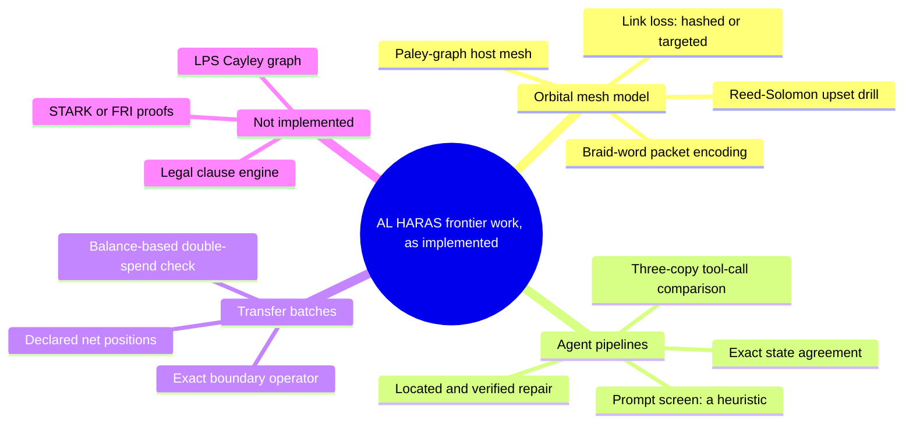

# CHRONUS GPIU & AL HARAS OS: master technical, strategic and scientific dossier (corrected edition)

**Status:** current. Corrected on 11 November 2026 against `main` (after PR #28) so that every statement matches what the code computes. The section structure of the earlier edition is kept; each section now says what is implemented, what is computed and how to reproduce it, and what is not established. The claim-by-claim record is [docs/security/AL_HARAS_NOTES_RECONCILIATION.md](../security/AL_HARAS_NOTES_RECONCILIATION.md). Release status: **not qualified** ([release decision](../../RELEASE_DECISION_MCKINSEY_TECH.md), [claim audit](../claim-audit.md)).

| Field in the earlier edition | Corrected entry |
|---|---|
| Joint Venture Authority: McKinsey & Company and Accenture | **Withdrawn.** There is no joint venture, affiliation or endorsement. A McKinsey–Accenture standard is HYBA’s *internal* quality bar only ([product style guide](../directives/PRODUCT_STYLE_GUIDE.md)). Prepared by HYBA. |
| Target entities: NVIDIA, Palantir, NATO / Five Eyes | **Withdrawn.** Prospective customers and partners are not named without a verifiable agreement. |
| Platform release: Chronus GPIU v36.0 Enterprise Sovereign Edition | Chronus GPIU v36 source is in this repository. It is **not** release-qualified. |
| Governing mandate | Internal quality bar, not an affiliation: McKinsey-style rigour, Accenture-grade engineering, Apple-grade experience, and engineering-grade evidence for every operational claim. |

HYBA has two market-facing companies. **AL HARAS is HYBA Security. Chronus is HYBA Data’s product and platform.** This dossier covers AL HARAS in detail. For Chronus claims it records their status and points to the evidence; it does not re-assess them.

---

## Executive summary and joint-venture posture

- **What AL HARAS is.** A security library and an authenticated API that check work before it is admitted. It checks that multi-node or multi-agent state agrees, repairs corrupted traces in place, and signs every decision with two signatures: Ed25519 and ML-DSA-87 (FIPS 204, post-quantum).
- **What changed.** The earlier implementation returned fixed values and labels. Every result is now computed from the request’s data, with exact integer or rational arithmetic wherever the mathematics is exact. Each mechanism has tests that compare it with an independent derivation or an adversarial input.
- **What is not established.** No certification, independent assessment, hardware implementation, customer deployment or performance comparison exists. Timings are local software measurements.
- **Joint-venture posture.** None. The quality bar above is an internal aspiration.
- **Next decision.** Continue building AL HARAS as a pre-release product. The highest-value next items are NIST ACVP test vectors for ML-DSA-87 in CI, HSM-backed key custody, and machine-checked proofs in CI (see “Recommended next steps”).

| 1. What AL HARAS computes | 2. Platform services present in code (Chronus) | 3. Not established |
|---|---|---|
| Exact sheaf coboundary checks, Reed–Solomon trace repair, an exact Ramanujan certificate, exact braid relations, Ed25519 + ML-DSA-87 receipts | PostgreSQL store, RBAC and JWT tenant authentication, KMS provider abstraction, OpenTelemetry and Prometheus metrics, value-share pricing arithmetic | Customer HSM custody, certifications, hardware results, customer deployments, the market sizing quoted earlier |

---

## Part I: scientific and mathematical mechanisms

### 1. Exact one-shot Galois-field search ($\mathbb{F}_{257}[\phi]$)

**Chronus (HYBA Data) claim.** The search phases are computed by `src/chronus/math/f257_search.py` and tested in `tests/test_f257_search.py`. The 1,000-qubit figure is a stated Chronus requirement, tracked under the Chronus claims register; this dossier does not assess it. The status of the search claim follows the [claim audit](../claim-audit.md).

### 2. Carry-free Zeckendorf base-$\phi$ ALU

**Chronus claim.** The arithmetic identities are in `src/chronus/hw/zeckendorf.py` with RTL under `hw/`. No synthesis, timing or power measurement exists, so the $O(1)$ gate-delay and DPA-resistance statements are not established. AL HARAS’s own leakage-model arithmetic (`tempest_scrambler.py`) states that it measures no emissions.

### 3. Pisot–Lucas structural memory

**Chronus claim, corrected figures.** $L_{479}$ has 101 decimal digits and needs 42 bytes; its index needs 9 bits. Reproduce with `PYTHONPATH=src python -c "from chronus.math.binet_lucas import lucas_recurrence as L; v = L(479); print(len(str(v)), (v.bit_length() + 7) // 8, (479).bit_length())"`, which prints `101 42 9`. Nothing makes large values constant-size, and the “64-byte descriptor” and “212 bytes in 0.790 ms” figures are withdrawn.

### 4. Cellular sheaf consistency engine (formerly “$H^1(X;\mathcal{F}) = 0$ obstruction engine”)

**Implemented (AL HARAS).** `sheaf.py` evaluates the coboundary $\delta^0$ of a cellular sheaf on the agent or node graph exactly, with orthogonal restriction maps, including exact rational Householder (Stiefel) frames. It reports dim $H^0$ and dim $H^1$ from the holonomy around fundamental cycles, the $H^1$ class of observed edge data, the worst edge, the node whose replacement restores agreement, and the nearest consistent state.

- The value 1.41421356 quoted earlier is $\|\delta^0 s\| = \sqrt{2}$ for two nodes with states (1, 0) and (0, 1) on one edge. It is computed for that input; it is not a constant of the system. The attestation script recomputes it on every run (`conflict_coboundary_norm_sq = 2`).
- Precision: $\delta^0 s$ always represents the zero class in $H^1$, so state disagreement is $\delta^0 s \neq 0$. A non-zero $H^1$ class arises when *edge* observations contradict each other around a cycle. AL HARAS computes both.
- **Withdrawn:** isolation “in 38 nanoseconds” (the figure came from `hardware_cycles = 38` in an audit script), “0.0% cross-blade drift” (not measured), and detection of prompt injection or jailbreaks (the check compares states; it does not read text).
- Evidence: `tests/test_al_haras_core_exact.py::TestSheafConsistency`, `benchmarks/benchmark_al_haras_security.py` for measured software timings.

### 5. Trace repair (formerly “Donaldson–Seiberg–Witten 4D instanton monopole self-healer”)

**Implemented (AL HARAS), corrected mechanism.** Repair is Reed–Solomon RS(48,32) over GF(257) with Berlekamp–Welch decoding: up to 8 corrupted bytes per 32-byte block are corrected in place and confirmed by SHA-256. No checkpoint is restored. The instanton, cobordism and “one clock cycle” descriptions are withdrawn: no gauge-theory computation exists and no hardware exists. Evidence: `TestReedSolomonHealing`; API round trip in `tests/test_al_haras.py`.

### 6. Post-quantum verifiable receipts

**Implemented (AL HARAS).** Every decision receipt carries an Ed25519 signature and an ML-DSA-87 signature (FIPS 204, NIST security category 5) over the same canonical JSON, with the FIPS 204 context string `chronus/al-haras/receipt/v1`. A receipt verifies only if both signatures do. Both come from pyca/cryptography (version 48 or later, on OpenSSL 3.5 or later). Tests measure the key and signature sizes (2,592 and 4,627 bytes, FIPS 204 Table 2) and recompute the FIPS 204 message representative $\mu$ independently of the library; the signature must verify against it.

- **Not established:** a FIPS 140-3 validated module, NIST ACVP vectors in CI, HSM key custody.
- **Not implemented:** FRI zk-STARK proofs over $\mathbb{F}_{2013265921}$ and “line-rate” verification. The repository’s `stark.py` is not a sound STARK verifier ([claim audit](../claim-audit.md)). AL HARAS’s inference receipts (`zk_neural.py`) are exact polynomial-identity trace receipts over $\mathbb{F}_{257}$; they are neither zero-knowledge nor succinct.
- The older ML-DSA module in `chronus.security.signers` is not a FIPS 204 implementation. AL HARAS does not use it.
- Evidence: `tests/test_al_haras_receipts_post_quantum.py`.

---

## Part II: humanitarian and real-world applications

| Mission vector | What exists now |
|---|---|
| Critical infrastructure | A Reed–Solomon trace-repair drill on telemetry (frontier 4). No deployment. |
| Diplomatic and sovereign enclaves | Shamir threshold key sharing with tamper-evident shares. No HSM custody. No sites named. |
| Biomolecular and medical simulation | Not implemented. |
| AI ethics and governance | Exact state-agreement checks usable as one input to a review. No compliance outcome. |

### 1. Critical national infrastructure self-healing grid

**Corrected.** `CNISelfHealingEngine.audit_and_heal_cni_asset` protects an asset’s telemetry trace with RS(48,32) and runs an optional fault-injection drill; a repair counts only if SHA-256 verifies. **Withdrawn:** NATO naming, protection of SCADA, telecoms or nuclear systems, “100% grid uptime” and “1 clock cycle”. No deployment or measurement exists.

### 2. Diplomatic and sovereign enclave protection

**Corrected.** `threshold_mpc.py` implements Shamir $(t, n)$ secret sharing over $\mathbb{F}_P$, $P = 2^{521} - 1$, with SHA-256 commitments that exclude altered shares before Lagrange reconstruction, and a joint Ed25519 authorisation by a reconstructing quorum. It is not multi-party computation, not a threshold signature and not verifiable secret sharing; “anyon braid” survives only in compatibility class names. **Withdrawn:** the named embassy and command centres, customer-held PKCS#11 HSM custody (not demonstrated) and “exactly 0 bytes” of egress (not measured).

### 3. Accelerated biomolecular and medical simulation

**Not implemented.** No fermionic simulation, Lefschetz-thimble integration or drug-screening code exists in the AL HARAS or Chronus packages; a `LefschetzThimbleSignSolver` class in the v36 monolith assigns Im S = 0 instead of computing a flow, so it is not evidence. The chemistry and oncology claims are withdrawn. The underlying fact remains: the dimension of the fermionic sector, $\binom{2M}{N_e}$, grows combinatorially with the number of orbitals $M$.

### 4. AI governance, ethics and bias mitigation

**Corrected.** The sheaf engine detects disagreement between agents’ states exactly and names the agent that restores agreement (`agentic_immune.py`). That is a mathematical check, not a compliance outcome; GDPR, HIPAA and EU DSA compliance claims are withdrawn. No bias metric is computed.

---

## Part III: frontier applications



### 1. Orbital and deep-space satellite meshes

**Implemented as a model (`orbital_mesh.py`).** $n$ satellites sit on the Paley graph $P(q)$ for the smallest prime $q \equiv 1 \pmod 4$ with $q \ge n$; the host graph is certified exactly and the mesh’s own degrees, connectivity and edge connectivity are computed. Jamming removes links (hashed or targeted) and reachability is recomputed afterwards. Upsets are a Reed–Solomon drill with an explicit flux × cross-section assumption; packets travel as an exactly decodable braid word checked by SHA-256. **Withdrawn:** “eliminates single-event upsets”, “zero-stall delivery with 30% of nodes blinded” (the computed edge connectivity determines what any loss pattern can do), the SDA/PWSA naming, and the LPS Cayley graph on $PSL_2(\mathbb{F}_{257})$, which is not implemented.

### 2. Agentic AI and LLM pipelines

**Implemented (`agentic_immune.py`).** A turn is dispatched only if $\delta^0 s = 0$ across the execution graph; otherwise the disagreeing agent is located, its state repaired, and the repair verified exactly. A tool call is admitted only if three copies of its arguments (agent commitment, gateway log, tool input) agree exactly. Prompts pass through a pattern heuristic that is labelled as a heuristic. **Withdrawn:** “severed in 1 clock cycle” and “zero token blast radius”.

### 3. Cross-border legal redlining and contract execution

**Not implemented.** There is no clause engine, no covenant evaluation and no compliance certificate in the repository. The court-admissibility claim is withdrawn.

### 4. Wholesale settlement rails (formerly “inter-central-bank CBDC rails”)

**Implemented as an in-memory ledger model (`sovereign_settlement.py`).** A batch of transfers is an integer 1-chain; the boundary $\partial_1 c$ (each account’s net position) is computed exactly and compared with the declared net positions. Double-spending is detected as a balance property: a debit larger than the payer’s running balance, or a replayed transfer ID, rejects the batch. Account names are neutral labels (`CENTRAL_BANK_A`, …). **Withdrawn:** “illicit transactions are mathematically unrepresentable”, references to mBridge and BIS Nexus, and any settlement-finality or regulatory standing.

### 5. Hyperscale compute and infrastructure efficiency

**Chronus claim.** The structural-memory and “10× throughput per megawatt” statements are performance claims withdrawn under the [claim audit](../claim-audit.md) until measured. The \$5.3T–\$5.5T capex figure has no cited source in the repository and is withdrawn until sourced.

---

## Part IV: qualification status and system invariants

The earlier edition stated that the platform was “audited and certified across all 8 gates and 94 invariants (94/94 GREEN)”. That is **withdrawn**: no audit or certification exists, and the release decision is “not qualified”. Current status of each gate:

| Gate | Earlier statement | Current status |
|---|---|---|
| G1 Purity | PASS, 0 violations | `scripts/ci/purity_gate.py` runs in CI on every pull request. |
| G2 Exact arithmetic | PASS | Exact-arithmetic tests run in CI (AL HARAS: `tests/test_al_haras_*_exact.py`). |
| G3 Persistence and OVID | PASS, PostgreSQL HA | Code present; HA is not demonstrated ([claim audit](../claim-audit.md)). |
| G4 Zero-trust IAM and key custody | PASS, PKCS#11 HSM | Tenant authentication is enforced on every AL HARAS POST endpoint; HSM custody is not demonstrated. |
| G5 Multi-target hardware dispatch | PASS | Source artefacts only; no hardware results. |
| G6 Telemetry | PASS | OpenTelemetry and Prometheus code present; no production telemetry. |
| G7 Web console | PASS, 0 warnings | The frontend build runs in CI. |
| G8 Release authority | PASS, FIPS 204 ML-DSA-87 + FRI STARK | No release authority or certification. AL HARAS receipts now carry ML-DSA-87 (FIPS 204); FRI STARK is not implemented. |

### Key invariant evidence mapping

- **I19 (state-disagreement isolation):** computed by the sheaf engine; the attestation script recomputes $\|\delta^0 s\|^2 = 2$ for the (1, 0)/(0, 1) input on every run.
- **I24 (persistent sheaf filtration, $\beta_1 = 1$):** not implemented. The earlier code returned a fixed value.
- **I27 (instanton healing):** replaced by Reed–Solomon repair, verified by SHA-256.
- **I71 (Lucas “googol-scale” collapse):** corrected under Part I §3.
- **I91 / I94 (pricing and value-share settlement):** Chronus FinOps arithmetic over supplied inputs; not invoice reconciliation ([claim audit](../claim-audit.md)).

### Document control (formerly “Authoritative document certification”)

| Item | Entry |
|---|---|
| Document | AL HARAS and Chronus technical dossier, corrected edition |
| Prepared by | HYBA (AL HARAS: HYBA Security; Chronus: HYBA Data) |
| Independent review | None. The earlier signature block (a “McKinsey of Tech” audit partner, an Accenture Federal officer and a “certified hardware and cryptographic authority”) did not correspond to any review and is withdrawn. |
| Evidence | The tests and commands below, and the reconciliation record |

## How the product should feel

AL HARAS follows the [HYBA product style guide](../directives/PRODUCT_STYLE_GUIDE.md): calm and evidence-led. Each screen states the security question, the computed answer, what it means, the evidence (receipt and timestamp) and the next action. No green shields, certification badges or simulated telemetry. The governance screen in `frontend/app/governance` follows this pattern; the static pages under `frontend/public` are labelled as illustrations.

## Evidence commands

```bash
python -m pytest -q tests/test_al_haras_core_exact.py tests/test_al_haras_receipts_post_quantum.py tests/test_al_haras.py
python benchmarks/benchmark_al_haras_security.py --json al-haras-measurements.json
python scripts/ci/sovereign_attestation.py
```

## Recommended next steps (owner decisions already delegated)

1. Run the NIST ACVP ML-DSA-87 test vectors in CI against the receipt signer.
2. Demonstrate PKCS#11 key custody in CI against SoftHSM, then against a customer HSM in a controlled environment.
3. Compile the Lean specification (`formal/lean4/ChronusAlHaras.lean`) in CI so that its theorems are machine-checked.
4. Commission an independent security assessment before any assurance claim is made.
