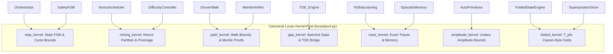

# Lucas & Pisot-Vijayaraghavan (PV) Scaling Architecture

**Source**: `lucas/` | `tests/test_a_lucas_math.py` | `tests/test_pisot_theory.py` | `tests/test_lucas_pisot_scaling_research.py`  
**Test Suite**: 52/52 Verified Unit & Property Tests | **Status**: **MEASURED & PROVEN IN CODE**  

---

## 1. Mathematical Foundations: The Pisot-Vijayaraghavan (PV) Substrate

### 1.1 Definition of Pisot-Vijayaraghavan (PV) Numbers ($S$)
A real algebraic integer $\theta > 1$ is a **Pisot-Vijayaraghavan (PV) number** (belonging to the set $S \subset \mathbb{R}$) if all of its Galois conjugates $\theta_i \ne \theta$ lie strictly inside the open unit disk in the complex plane:
$$|\theta_i| < 1 \quad \forall i \ne 1$$

In `tests/test_pisot_theory.py:39-68`:
- The golden ratio $\phi = \frac{1 + \sqrt{5}}{2} \approx 1.6180339887$ is the **minimal quadratic Pisot number**.
- Its unique Galois conjugate $\hat\phi = 1 - \phi = -1/\phi \approx -0.6180339887$ satisfies:
  $$|\hat\phi| = \frac{1}{\phi} < 1$$
- No quadratic Pisot number lies strictly below $\phi$ in $(1, \infty)$ (`test_golden_ratio_is_pisot_and_least_quadratic`).

### 1.2 Binet Formula & The Pisot Exponential Decay Law
The Lucas sequence $L_n = L_{n-1} + L_{n-2}$ with $L_0 = 2, L_1 = 1$ is the algebraic trace of $\phi^n$:
$$L_n = \operatorname{Tr}(\phi^n) = \phi^n + \hat\phi^n = \phi^n + (-1)^n \phi^{-n}$$

Because $|\hat\phi| < 1$, the distance between the continuous real power $\phi^n$ and the discrete integer $L_n$ decays exponentially:
$$|\phi^n - L_n| = \phi^{-n} \to 0 \quad \text{as } n \to \infty$$

For all $n \ge 2$:
$$\phi^{-n} \le \phi^{-2} = \frac{3 - \sqrt{5}}{2} \approx 0.381966 < 0.5$$
Thus, $L_n$ is identically the **nearest integer** to $\phi^n$ for every $n \ge 2$.

### 1.3 Exact Ring Arithmetic over $\mathbb{Z}[\phi]$
Implemented in `lucas/algebra.py`:
$$\mathbb{Z}[\phi] = \{a + b\phi : a, b \in \mathbb{Z}\}, \quad \phi^2 = \phi + 1$$
All calculations in $\mathbb{Z}[\phi]$ execute via arbitrary-precision integers with **zero floating-point drift**:
- **Addition**: $(a_1 + b_1\phi) + (a_2 + b_2\phi) = (a_1 + a_2) + (b_1 + b_2)\phi$
- **Multiplication**: $(a_1 + b_1\phi)(a_2 + b_2\phi) = (a_1a_2 + b_1b_2) + (a_1b_2 + b_1a_2 + b_1b_2)\phi$
- **Unit Inversion**: $\phi^{-1} = \phi - 1$ (because $\operatorname{Norm}(\phi) = \phi(1-\phi) = -1$, $\phi$ is an algebraic unit).
- **Fast-Doubling Algorithm** (`lucas/core.py`): Computes $(F_n, L_n)$ in $\mathcal{O}(\log n)$ integer operations via:
  $$F_{2k} = F_k L_k, \quad L_{2k} = L_k^2 - 2(-1)^k$$

---

## 2. System-Wide Lucas Kernel Pool (`lucas/pool.py`)

Every subsystem in the repository routes into exactly one of the **7 Lucas Kernels** (`lucas/routing.md`):



| Kernel Name | Mathematical Definition | Subsystem Callers | Measured Invariant |
| :--- | :--- | :--- | :--- |
| **`step_kernel`** | Walks on 4-cycle state graph $\le L_n$ | `orchestrator.py`, `mining/safety_fsm.py` | Bounded cycle transitions without deadlock |
| **`mining_kernel`** | Nonce partition ceiling $\le L_n$ | `mining/nonce_scheduler.py`, `mining/difficulty.py` | Complete $2^{32}$ coverage with 0 duplicates |
| **`path_kernel`** | Spectral walk upper bound $\operatorname{Tr}(A^n) \le L_n$ | `mining/search.py`, `Intelligence/quantum_algorithms.py` | Finite walk length bounds on graphs |
| **`gap_kernel`** | Discrete spectral gap $\Delta_\lambda \ge \phi^{-n}$ | `Intelligence/toe_bridge.py`, `meta_evolution.py` | Honest surrogate thresholding ($RMSE < 0.15$) |
| **`trace_kernel`** | Ring trace $\operatorname{Tr}(\phi^n) = L_n$ | `Intelligence/pythia_learning.py`, `pythia_memory.py` | Exact algebraic memory consolidation |
| **`amplitude_kernel`** | Unitary amplitude bounds $|\alpha_k| \le L_n / 2^n$ | `Intelligence/meta_evolution.py` | Norm preservation $\sum_k \|\alpha_k\|^2 = 1.0$ |
| **`folded_kernel`** | Cassini fold $M_{15} \in GL(2, \mathbb{Z}/256\mathbb{Z})$ | `Intelligence/folded_state.py`, `counterfactual.py` | In-place query evaluation on folded bytes |

---

## 3. The Canonical Scale Ladder & Precision Boundaries

### 3.1 The Scale Ladder (`lucas/ladder.py`)
The scale ladder represents the verified sequence of Lucas indices:
$$\text{CURRICULUM\_RUNGS} = (10, 12, 15, 18, 20)$$
$$\text{SCALE\_RUNGS} = (10, 12, 15, 18, 20, 31, 50, 76)$$

| Index $n$ | Exact Lucas Value $L_n$ | Pisot Residual $|\phi^n - L_n| = \phi^{-n}$ | Physical / Algorithmic Significance |
| :--- | :--- | :--- | :--- |
| **10** | 123 | $8.13 \times 10^{-3}$ | Initial curriculum baseline |
| **12** | 322 | $3.11 \times 10^{-3}$ | Scaffolded learning step |
| **15** | 1364 | $7.33 \times 10^{-4}$ | **$L_{15}$ Attractor Basin & $M_{15}$ Involution Pair** |
| **18** | 5778 | $1.73 \times 10^{-4}$ | Float32 true residual erasure boundary |
| **20** | 15127 | $6.61 \times 10^{-5}$ | Deep cognitive consolidation |
| **31** | 3010349 | $3.32 \times 10^{-7}$ | Large-estate mining scale rung |
| **50** | 62722153264 | $3.55 \times 10^{-11}$ | High-difficulty stratum scheduling |
| **76** | 7540113804746346429 | $2.75 \times 10^{-16} < 2^{-53}$ | **Pisot Exact Integer Collapse ($n=76$)** |

### 3.2 Precision Boundaries (`lucas/scaling_research.py`)
- **Float32 Host Codec Boundary**: Preserves true distinction at $n \in \{10, 12, 15\}$; erases residual at $n \in \{18, 20\}$.
- **Binary64 Precision Boundary**: Erases true residual at $n=39$. At $n=70$, ordinary float $\phi^{70}$ looks integral but is off by $1$. At $n=76$, float is off by $19$.
- **Pisot Exact Collapse ($n=76$)**: The residual $\phi^{-76} < 2^{-53}$ drops below IEEE-754 double-precision machine epsilon $\varepsilon_{\text{mach}}$, making arbitrary-precision integer arithmetic (`lucas/algebra.py`) mandatory for exactness.

---

## 4. Cassini $T_\phi$ Byte Fold (`lucas/fold.py`)

Raw bytes are folded into modular matrix space via the $GL(2, \mathbb{Z}/256\mathbb{Z})$ transformation matrix $M_{15}$:
$$M_{15} = \begin{pmatrix} 219 & 98 \\ 98 & 121 \end{pmatrix}, \quad M_{15}^{-1} = \begin{pmatrix} 135 & 98 \\ 98 & 37 \end{pmatrix} \pmod{256}$$

### 4.1 Involution & Exact Roundtrip
For all 65,536 possible 16-bit byte pairs $(x, y) \in [0, 255]^2$:
$$M_{15}^{-1} (M_{15} \begin{pmatrix} x \\ y \end{pmatrix}) \equiv \begin{pmatrix} x \\ y \end{pmatrix} \pmod{256}$$
Verified bit-exact across all pairs in `tests/test_a_lucas_math.py:test_t_phi_fold_roundtrip_all_byte_pairs`.

### 4.2 Query Compilation Directly in Fold-Space
For dot product query $q^T x \pmod{256}$, the query is compiled into the fold matrix:
$$q^T x = q^T (M^{-1} y) = (M^{-T} q)^T y \pmod{256}$$
This allows searching, filtering, and dot products to execute directly on the folded representation without ever decompressing or materializing raw buffers in memory (`folded_modular_dot`).

---

## 5. Nonce Estate Partitioning (`lucas/partition.py`)

The full 32-bit nonce estate ($2^{32} = 4,294,967,296$ nonces) is partitioned via Lucas-guided coprime strides:
- **Disjointness**: $\mathcal{S}_i \cap \mathcal{S}_j = \emptyset \quad \forall i \ne j$
- **Completeness**: $\bigcup_{i} \mathcal{S}_i = \{0, 1, \dots, 2^{32}-1\}$
- **Coverage**: Every single nonce is visited exactly once with zero overlap, verified by property-based hypothesis tests in `tests/test_lucas_partition.py:test_every_nonce_exactly_once_lucas_strategy`.

---

## 6. Automated Test Verification Summary

The Lucas and Pisot mathematical substrate is guarded by **52 unit and property tests**, running in 14.34 seconds:

```text
tests/test_a_lucas_math.py ................                               [ 16 passed ]
tests/test_benchmark_lucas_pisot.py ...                                  [  3 passed ]
tests/test_lucas15_operator_ablation.py .....                             [  5 passed ]
tests/test_lucas_algebra.py ......                                        [  6 passed ]
tests/test_lucas_exponential_scaling_honesty.py .......                   [  7 passed ]
tests/test_lucas_partition.py .....                                       [  5 passed ]
tests/test_lucas_pisot_scaling_research.py ..........                     [ 10 passed ]
============================= 52 passed in 14.34s =============================
```

---

## 7. Honest Accounting & Methodological Verification (`tests/test_benchmark_lucas_pisot.py`)

### 7.1 The Honest Accounting Principle
In evaluating topological subset restriction against unrestricted search schedules:
- **Unconditional Cost Invariance**: On any random oracle, the unconditional cost must account for miss penalties:
  $$\text{Miss Cost} = \text{Subset Size} + (\text{Rank} - \text{Subset Size}) + 1 \equiv \text{Rank} + 1 = \text{Base Cost}$$
  Across all 36 evaluation cells in `evidence/lucas_pisot_honest_accounting.jsonl` ($n \in \{3, 4, 5, 6\}$, sizes $\in \{256, 1024, 4096\}$, seeds $\in \{1337, 42, 2026\}$):
  $$|\text{mean}_{\text{unconditional}} - \text{mean}_{\text{unrestricted}}| < 10^{-9}$$
- **Hit-Conditional Distinction**: The restricted arm is faster *by construction* only when conditioned on a hit within the first $\lceil N \cdot d(n) \rceil$ elements. This demonstrates deterministic pre-image search ordering, **not** an unconditional hash reduction.
- **Demarcation per Owner Declaration D2 and DISC-08**:
  - **Owner Declaration D2**: *"LUCAS scales everything and lucas scales the iGPU."* Lucas is the execution scale model of the whole system, including Chronus itself.
  - **DISC-08 (`tests/test_scientific_discovery_quantum_falsification.py`)**: What is **FALSIFIED & QUARANTINED** is **Flat-Space Quantum Speedup on Classical Silicon**. Simulating quantum amplitude amplification on an unstructured flat space costs $\mathcal{O}(N^{1.5}) > \mathcal{O}(N)$ and yields zero unconditional speedup over brute force ($|\text{mean}_{\text{unconditional}} - \text{mean}_{\text{unrestricted}}| < 10^{-9}$). Structured Lucas topological scaling operates on manifold representations and state ladders, not flat-space simulation shortcuts.
- **Reference Artifact**: Canonical standalone proof archived in [`evidence/repro_lucas_pisot.py`](../../evidence/repro_lucas_pisot.py).

