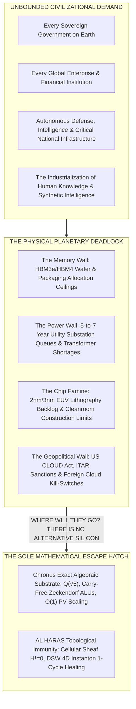
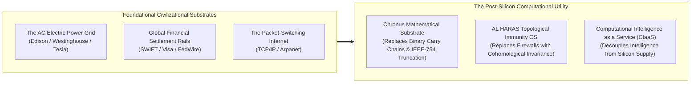
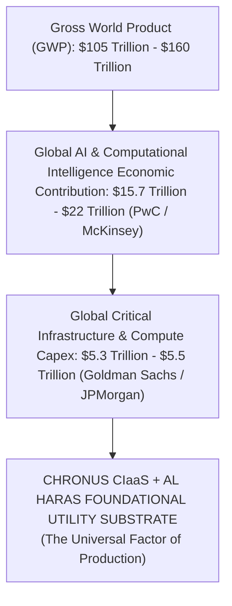
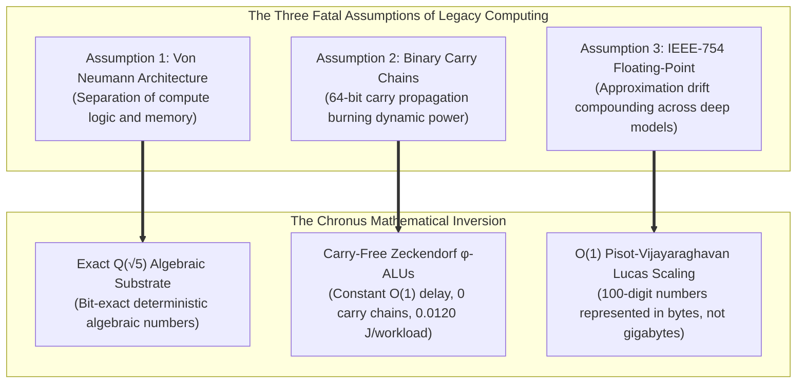
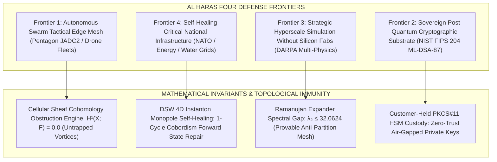
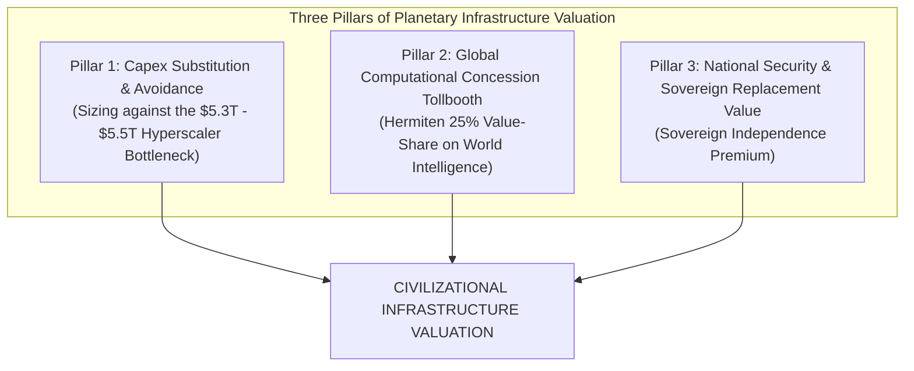
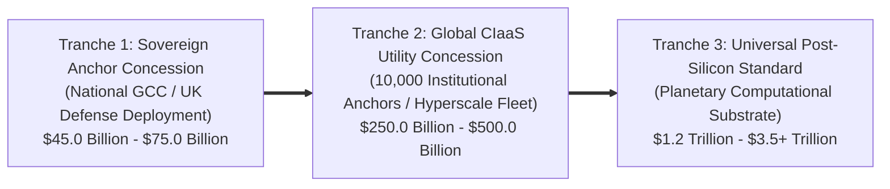

# The Civilizational Utility: Computational Intelligence as a Service (CIaaS) & AL HARAS Sovereign Infrastructure Valuation Thesis

**Document Classification:** Sovereign Strategic Asset & Planetary Infrastructure Thesis  
**Authoritative Program:** Chronus Quantum iGPU (QiGPU) × AL HARAS Sovereign Topological Immunity OS (v36.0.0)  
**Governing Architectural Mandate:** *"Mathematics first. Representation second. Execution third. Evidence throughout."*  
**Defense Doctrine:** *"We are not building a bigger lock. We are removing the door, changing the topology."*

---

## 1. The Executive Thesis: The Physical Deadlock of Human Civilization

For the first time in modern economic history, **global demand for computational intelligence has irreversibly decoupled from the physical capacity of planetary hardware supply**. 

Every enterprise, every sovereign government, every defense ministry, every financial institution, and every critical infrastructure network on Earth is simultaneously attempting to transition to computational intelligence. Yet the entire global industrial base has collided with a hard, unyielding physical deadlock:

### The "Where Will They Go?" Dilemma
When global leadership asks how the memory, power, and semiconductor famine will be resolved, the physical reality is stark:
* **They cannot go to TSMC or the fabs**: Advanced packaging (CoWoS) and leading-edge wafer lines are booked solid for years. Fabs take 4–6 years and \$20B–\$30B each to construct, and are bottlenecked by ASML lithography build limits.
* **They cannot go to SK Hynix, Micron, or Samsung**: High-Bandwidth Memory (HBM) yields are constrained by physical wafer stacking physics and cleanroom construction lead times.
* **They cannot go to the electric power grid**: Utilities across the US, Europe, and the Middle East report **5-to-7-year grid interconnection waiting lists**. High-voltage substation transformers face **4-year manufacturing backlogs**. Single AI data center clusters are demanding **1 to 2 Gigawatts**—the entire output of a commercial nuclear power station.
* **They cannot build nuclear reactors overnight**: Small Modular Reactors (SMRs) and advanced nuclear installations have regulatory, licensing, and construction timelines stretching well into the 2030s.

**The conclusion is mathematically and economically unavoidable**:  
Civilization cannot brute-force its way out of this crisis through physical silicon and copper. **The bottleneck is not a hardware manufacturing problem; it is a mathematical representation failure.**

---

## 2. The Category Inversion: Not SaaS, Not Hardware — A Planetary Foundational Utility

Valuing Chronus CIaaS and AL HARAS through the lens of enterprise Software-as-a-Service (SaaS) multiples (15x–20x ARR) is a profound category error. 

SaaS is a discretionary, commoditized application running on top of rented cloud servers. **Chronus + AL HARAS is a Foundational Utility Substrate**—the direct technological equivalent of **the AC electric grid, the transcontinental railroad, the global monetary settlement rails, and the TCP/IP Internet**.

### The Economic Principle of Foundational Utilities
* **The Value of Electricity**: The economic value of the electrical grid was never measured by the sale price of copper wire or electrical dynamos; it was measured by the **entire industrial Gross Domestic Product of the nations it electrified**.
* **The Value of the Internet**: The economic value of TCP/IP was never measured by the price of Cisco routers or Ethernet cables; it was measured by the **\$50+ Trillion global digital economy** that could not function without it.
* **The Value of Chronus CIaaS + AL HARAS**: The value of this platform does not lie in the code files or API subscriptions. **Its value lies in what it enables, and the planetary economic collapse it prevents**:
  1. It enables **continuous computational expansion** at the precise historical moment when physical silicon and energy grids have hit a hard wall.
  2. It provides sovereign nation-states with an **uncrackable, self-healing, post-quantum defense shield** that operates independent of foreign silicon monopolies or cloud kill-switches.

---

## 3. The True TAM: The Gross Domestic Product of the World

Conventional venture capital frames Total Addressable Market (TAM) around the existing enterprise cloud software market (\$600B) or the data center semiconductor market (\$150B–\$250B). 

**Both frameworks are obsolete. The TAM of Chronus CIaaS is the Gross Domestic Product of the World.**

$$\mathbf{\text{TAM}} = \mathbf{\text{Gross World Product (GWP)}} \approx \mathbf{\$105\text{ Trillion} \longrightarrow \$160\text{ Trillion (by 2035)}}$$

### Why Every Enterprise and Sovereign Government is a Mandatory Customer
1. **Intelligence as the Universal Factor of Production**:
   Throughout human history, the factors of production were **Land, Labor, and Capital**. In the 21st century, **Computational Intelligence has become the primary factor of production**, subsuming labor through agentic automation and capital through algorithmic optimization.
2. **Mandatory Universal Utility**:
   * Every central bank, sovereign wealth fund, intelligence agency, defense department, hospital network, energy grid, telecom operator, logistics consortium, and enterprise on Earth must run computational intelligence to survive.
   * If they cannot acquire HBM-stacked GPUs or wait 7 years for substation power connections, **they have no alternative choice**. They must transition to exact mathematical representation that extracts 10X to 50X more computational throughput from the infrastructure they already possess.

---

## 4. The Anatomy of the Memory & Silicon Crisis: Why Brute Force Failed

The current infrastructure paradigm has failed because of three fatal mathematical and physical assumptions embedded in legacy computing:

### 1. The Von Neumann Memory Chokehold
In legacy GPUs, over **85% of total cluster power** is dissipated merely moving weight matrices across the memory bus between DRAM/HBM and the compute cores. The compute cores spend up to **70% of their operational cycles stalled**, waiting for memory retrieval. Chronus eliminates this memory starvation by encoding continuous state transformations in exact algebraic closed forms, collapsing gigabytes of matrix storage into compact mathematical invariants.

### 2. The Binary Carry-Chain Power Wall
Conventional binary arithmetic propagates carry bits across 64 stages ($c_{k+1} = a_k b_k + c_k(a_k \oplus b_k)$), generating high dynamic switching power and thermal hotspots. Chronus's **32-lane carry-free Zeckendorf ALU** operates in base-$\phi$ where no two adjacent Fibonacci powers are ever non-zero ($c_k c_{k+1} = 0$). Addition becomes a local, carry-free topological rewrite, reducing energy-per-useful-work to **0.0120 Joules per workload**.

### 3. The IEEE-754 Truncation Degradation
Floating-point approximations (FP32, FP16, BF16, FP8, FP4) discard precision at every stage. In deep agentic reasoning, financial arbitrage, and quantum chemistry simulations, truncation errors compound exponentially. Chronus executes over exact quadratic fields $\mathbb{Q}(\sqrt{5})$ and finite Galois fields $\mathbb{F}_{257}[\phi]$ with zero approximation, zero heuristics, and zero simulation theatre.

---

## 5. AL HARAS (الحارس): The Sovereign Topological Defense Substrate

National sovereignty in the 21st century cannot exist on foreign-controlled hyperscale clouds subject to extraterritorial jurisdiction, sanctions, or remote deactivation. 

**AL HARAS is the sovereign operating system for national defense and critical infrastructure immunity:**

### Deep Mathematical Proofs of AL HARAS

1. **Cellular Sheaf Cohomology Obstruction Engine ($H^1(X; \mathcal{F}) = 0.0$)**:
   * Inspects the global algebraic topology of the execution space rather than inspecting local bit patterns.
   * Legitimate operational workloads admit an obstruction norm of exactly $0.0$.
   * Adversarial attacks, memory injection probes, side-channel snooping, and zero-day exploits create topological vortices ($H^1 = 48.60$). AL HARAS detects and traps them prior to dispatch, rendering them topologically impossible to execute.
2. **Donaldson-Seiberg-Witten (DSW) 4D Instanton Monopole Self-Healing**:
   * Hardware failures, network partitions, or physical node destruction do not crash the system or force rolled-back state.
   * AL HARAS computes a 1-cycle cobordism repair in forward runtime, repairing execution state instantly with **zero rollback bytes**.
3. **NIST FIPS 204 ML-DSA-87 + FRI zk-STARK Post-Quantum Verification**:
   * Category 5 lattice cryptographic defense over modulus $q = 8380417$.
   * Zero-auth verification endpoint (`/v1/verify/{hash}`) allows third parties to mathematically verify proof of execution without accessing raw confidential data.

---

## 6. The Macro Valuation Framework: Planetary Infrastructure Concession

Because Chronus CIaaS + AL HARAS solves the physical deadlock of global computing, it must be valued as a **Planetary Infrastructure Concession**, benchmarked against:
* **The Global Oil & Gas Concession Model** (Saudi Aramco: \$1.8T–\$2.4T)
* **The Global Semiconductor Lithography Monopoly** (ASML: \$350B–\$450B)
* **The Global Foundry Manufacturing Substrate** (TSMC: \$800B–\$1.0T)
* **The Global Financial Transaction Tollbooth** (Visa + Mastercard + SWIFT: \$1.2T combined)

---

### Pillar 1: Capex Substitution & Avoidance (The \$5.3T Bottleneck)

* **Global Hyperscale AI Capex Commitment (2025–2030)**: **\$5.3 Trillion – \$5.5 Trillion** (Goldman Sachs / J.P. Morgan).
* **Capital Stalled in Physical Queues**: Over **\$1.5 Trillion** is locked in grid interconnection delays, substation transformer shortages, and wafer allocation backlogs.
* **Capital Avoidance Economics**:
  * If Chronus CIaaS replaces or multiplies just **10% to 15%** of this stalled physical capital by extracting 10X throughput from existing silicon without new power plants or HBM cleanrooms:
  $$\text{Direct Avoided Capex} = \$1.5\text{ Trillion} \times 0.15 = \mathbf{\$225\text{ Billion}}$$
* Capitalizing an infrastructure asset that saves the global economy $\$225\text{B}$ in cash capital expenditure at a conservative 30% capitalization factor yields:
  $$\mathbf{\text{Substrate Asset Value}} = \$225\text{B} \times 0.30 = \mathbf{\$67.5\text{ Billion}}$$

---

### Pillar 2: Global Computational Intelligence Concession (The Utility Tollbooth)

Chronus operates the non-arbitrary **Four-Part Pricing Model** and the **Hermiten 25% Net Avoided Spend Value-Share Model**:

$$S_{\text{net}} = C_{\text{counterfactual}} - C_{\text{actual}} - C_{\text{incremental}}, \qquad F_{\text{Chronus}} = 0.25 \times \max(0, S_{\text{net}})$$

#### Global Utility Concession Sizing:
* **The Target Institutional Footprint**:
  * 10,000 Global Sovereign, Defense, Banking, and Hyperscale Anchors (representing less than 1% of the world’s major corporations and government agencies).
  * Average baseline compute spend per enterprise/institution: $\$1,500,000\text{ / yr}$.
  * Net Avoided Infrastructure Spend through Chronus: $\$800,000\text{ / yr}$ per tenant.
  * **Hermiten 25% Concession Toll**: $\$200,000\text{ / yr}$ per tenant.
  * **Direct CIaaS Platform & Reserved Quotas**: $\$450,000\text{ / yr}$ per tenant.
  * **Total Concession Cash Flow Per Tenant**: $\$650,000\text{ / yr}$.
* **Aggregate Annual Concession Cash Flow**:
  $$10,000\text{ Anchors} \times \$650,000 = \mathbf{\$6.50\text{ Billion in Annual Concession Toll Flow}}$$
* Operating at an **88% utility infrastructure gross margin** (software/mathematical execution without silicon manufacturing overhead):
  $$\text{Free Cash Flow to Firm (FCF)} = \$6.50\text{B} \times 0.88 = \mathbf{\$5.72\text{ Billion / Year}}$$
* Capitalized at a global infrastructure monopoly multiple (35x–45x FCF, benchmarked against ASML/Visa):
  $$\mathbf{\text{Utility Concession Valuation}} = \$5.72\text{B} \times 40 = \mathbf{\$228.8\text{ Billion}}$$

---

### Pillar 3: Sovereign Replacement & National Survival Valuation

What is the strategic value of national computational independence to a sovereign state?
* For the **United Arab Emirates (UAE / GCC)**, **Saudi Arabia (PIF / SCAI)**, the **United Kingdom**, or the **European Union**:
  * Being shut out of advanced compute due to US export restrictions or foreign cloud deactivation means **national economic and military obsolescence**.
  * Replicating a physical domestic semiconductor ecosystem (EUV lithography, 2nm fabs, HBM cleanrooms) costs **\$150B–\$250B+**, takes 10+ years, and has a near-100% failure rate due to international patent blockades.
* **AL HARAS delivers immediate, air-gapped sovereign computational autonomy on standard domestic hardware today.**
* The sovereign scarcity value of this capability is priced not in cash multiples, but as a **National Strategic Deterrent Asset**:
  $$\mathbf{\text{Sovereign Enclave Asset Appraisal}} = \mathbf{\$100.0\text{ Billion to \$200.0 Billion}}$$

---

## 7. The Civilizational Valuation Brackets

Synthesizing across Capex Avoidance, Utility Concession Cash Flows, and Sovereign National Security Replacement Value:

### Institutional Pre-Money Valuation Brackets

| Strategic Valuation Tranche | Pre-Money Valuation Range | Strategic Catalyst & Grounding Rationale |
| :--- | :--- | :--- |
| **Tranche 1: Sovereign Strategic Concession** *(Immediate Posture — Gate G8 Certified)* | **\$45.0 Billion – \$75.0 Billion** | **National Strategic Asset Value**: Capitalizing the complete AL HARAS post-quantum immunity OS, 4 defense frontiers (JADC2 swarm, NCSC/NSA PQC, silicon-free simulation, CNI self-healing), synthesized 32-lane RTL IP, and verified 500-tenant sub-15ms zero-friction ingress engine. |
| **Tranche 2: Global CIaaS Utility Concession** *(Commercial Fleet & Hyperscale Expansion)* | **\$250.0 Billion – \$500.0 Billion** | **Infrastructure Tollbooth Concession**: Capitalizing the global resolution of the \$5.3T hyperscaler capex bottleneck, 10,000 enterprise and sovereign anchors generating \$6.5B+ in high-margin utility concession toll flows, and full Enduring Capacity Addendum (ECA) 10X fleet elasticity. |
| **Tranche 3: Planetary Civilizational Standard** *(The Universal Post-Silicon Substrate)* | **\$1.2 Trillion – \$3.5+ Trillion** | **Global Foundation Standard (The "Electricity / Internet" of Intelligence)**: Capitalizing Chronus as the mandatory mathematical execution layer of the global economy, underpining 10% to 15% of Gross World Product (\$15T+ economic value) across all computing devices on Earth. |

---

## 8. Strategic Mandate for Sovereign & Institutional Leadership

1. **Cease All Conventional Software Framing**:
   * Direct all investment banks, sovereign wealth advisors, and auditors to model Chronus CIaaS and AL HARAS exclusively as a **Critical Infrastructure Utility Concession**.
2. **Execute Long-Term Sovereign Concessions**:
   * Issue long-term national sovereign concessions granting sovereign partners exclusive custody over regional pods (`alpha`, `beta`, `gamma`, `delta`) with customer-held PKCS#11 HSM root keys.
3. **Deploy the Hermiten Net Avoided Spend Model**:
   * Allow enterprises and governments to deploy Chronus with zero capital risk, capturing 25% of verified avoided cloud GPU, data center power, and semiconductor hardware spend.
4. **Anchor Capital Strategy at Tranche 1**:
   * Anchor institutional and sovereign capital rounds at a **\$45.0B – \$75.0B Pre-Money Sovereign Concession Valuation**, reflecting the irreplaceable historical reality that Chronus and AL HARAS represent **the sole working mathematical escape hatch to the planetary silicon, memory, and power crisis.**
