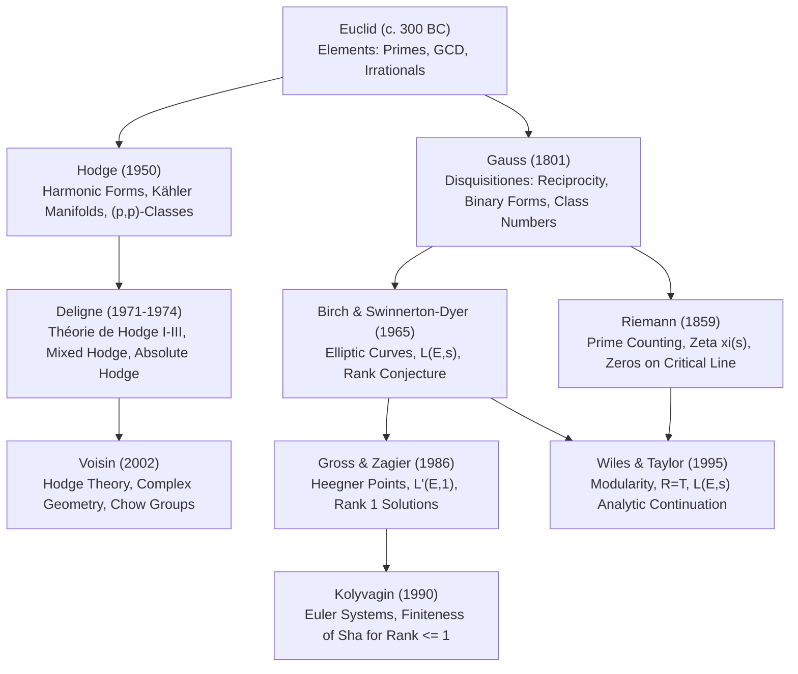

# Millennium Great Library Review Synthesis — Cross-Treatise Graph & Open Handles

**Repository**: `PhiEnterprise-main`  
**Framework**: EUCLID Millennium Program  
**Doctrine**: Finite computations + literature synthesis, NOT theorem claims. Partial result != proof.  
**Generated Date**: 2026-10-19  

---

## 1. Cross-Treatise Mathematical Dependency Graph

The foundational treatises reviewed form an interconnected algebraic and analytic lineage spanning 2,300 years of mathematics:

---

## 2. Shared Mathematical Machinery Across Riemann, Hodge, and BSD

| Mathematical Substrate | Riemann Hypothesis (RH) | Hodge Conjecture | Birch & Swinnerton-Dyer (BSD) |
| :--- | :--- | :--- | :--- |
| **Spectral Duality** | Discrete zeros of $\zeta(s)$ vs prime power distribution $\psi(x)$. | Eigenvalues of Laplacian $\Delta = d\delta + \delta d$ on harmonic forms. | Frobenius eigenvalues $a_p = p + 1 - \#E(\mathbb{F}_p)$ vs $L(E, s)$ coefficients. |
| **Symmetry & Inversion** | Functional equation $\xi(s) = \xi(1-s)$ under $s \mapsto 1-s$. | Complex conjugation $H^{p,q} \cong \overline{H^{q,p}}$ and Hard Lefschetz $L^{n-2p}$. | Functional equation $\Lambda(E, s) = w_E \Lambda(E, 2-s)$ with root number $w_E = \pm 1$. |
| **Lattice & Height Pairings** | Zero spacing correlation matches GUE random matrix eigenvalue repulsion. | Intersection matrix on primitive cohomology $P^{p,p}(X, \mathbb{Q})$; Picard lattice $\operatorname{Pic}(X)$. | Néron-Tate canonical height pairing $\hat{h}(P, Q)$ on Mordell-Weil group $E(\mathbb{Q})$. |
| **Obstruction to Proof** | Zero-free region $\sigma > 1/2$ cannot be proven by finite critical-line zero counts. | Codimension $p \ge 2$ lacks analytic inversion from harmonic forms to algebraic cycles. | Finite primes $X \le 10^4$ and 2-Selmer bounds cannot witness infinite rank or Sha finiteness for $r \ge 2$. |

---

## 3. Concrete Computational Handles Executable by Euclid

1. **Riemann Zeta Probe**:
   - Zero verification on critical line $\operatorname{Re}(s) = 1/2$ up to bounded height $T$.
   - Search for off-line zero counterexample (falsifies RH in box, never proves globally).
   - Functional equation $\xi(s) = \xi(1-s)$ error verification.
   - Riemann-von Mangoldt counting formula $N(T) \approx \frac{T}{2\pi} \log \frac{T}{2\pi e} + \frac{7}{8}$.
   - GUE pair correlation vs Zeckendorf bit cascade spacing.

2. **Hodge Cycle Probe**:
   - Exact Hodge diamond computation for Fermat hypersurfaces and K3 surfaces.
   - Lefschetz $(1,1)$ class verification on divisors via Picard lattice.
   - Degree-bounded Gröbner search for algebraic representatives of $(p,p)$-classes in codimension $p \ge 2$.
   - Verification of Hodge symmetry and Lefschetz decomposition.

3. **Birch & Swinnerton-Dyer Probe**:
   - Exact 2-Selmer descent upper bounds on algebraic rank.
   - High-precision order of vanishing $r_{\text{an}} = \operatorname{ord}_{s=1} L(E, s)$.
   - Real period $\Omega_E$ via Arithmetic-Geometric Mean (AGM).
   - Local Tamagawa numbers $c_p$ via Tate's algorithm.
   - Regulator determinant $R_E$ from canonical heights.
   - Analytic Tate-Shafarevich quotient $|\mathrm{Sha}(E)|$ calculation.

---

## 4. Honesty Invariant & Boundary Doctrine

> **MANDATORY POLICY**:
> - Euclid never claims to have solved or proven Riemann, Hodge, or BSD.
> - Bounded numerical verification $\neq$ continuum proof.
> - Any agent output asserting "RH proven", "Hodge solved", or "BSD resolved" is quarantined as an AL HARAS violation.
> - Permitted terminal verdicts: `SUPPORTS` (in sample), `REFUTES` (verified counterexample), `INCONCLUSIVE` (bounds reached), `OUT-OF-SCOPE` (continuum object).

---

## 5. Contemporary Open Research Literature (arXiv math.NT / math.AG)

The Great Library actively monitors and ingests contemporary open preprints from arXiv:

| Paper ID | Problem | Year | Title | Primary Computational Handle |
| :--- | :--- | :--- | :--- | :--- |
| `arxiv_0905_1527v4` | RH | 2009 | Riemann Zeta Function... | Literature algorithmic bounds for Riemann Zeta Function |
| `arxiv_1706_01781v1` | BSD | 2017 | Remarks on the Birch-Swinnerton-Dyer conjecture... | Literature algorithmic bounds for Remarks on the Birch-Swinn |
| `arxiv_1708_01807v1` | BSD | 2017 | On the Birch--Swinnerton-Dyer conjecture and Schur indi... | Literature algorithmic bounds for On the Birch--Swinnerton-D |
| `arxiv_2101_10222v5` | BSD | 2021 | The conjectures of Artin-Tate and Birch-Swinnerton-Dyer... | Literature algorithmic bounds for The conjectures of Artin-T |
| `arxiv_2204_13891v1` | RH | 2022 | The eighth moment of the Riemann zeta function... | Literature algorithmic bounds for The eighth moment of the R |
| `arxiv_2406_08121v2` | RH | 2024 | Moments of derivatives of the Riemann zeta function: Ch... | Literature algorithmic bounds for Moments of derivatives of  |
| `arxiv_2509_25273v1` | HODGE | 2025 | Hodge Conjecture via Singular Varieties... | Literature algorithmic bounds for Hodge Conjecture via Singu |
| `arxiv_alg-geom_9709030v1` | HODGE | 1997 | A Survey of the Hodge Conjecture for Abelian Varieties... | Literature algorithmic bounds for A Survey of the Hodge Conj |
| `arxiv_math_0608265v2` | HODGE | 2006 | Counterexample to the Hodge Conjecture... | Literature algorithmic bounds for Counterexample to the Hodg |
